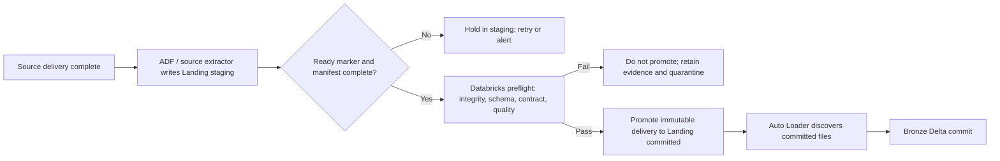

# Dataset and Source-to-Bronze Implementation Record

**Current alignment (2026-10-13):** The existing architecture was audited and strengthened in place in [docs/architecture/architecture.md](docs/architecture/architecture.md). This file remains the dataset/design-progress record, not a competing architecture. The selected files and existing source IDs are retained; verified source-semantic corrections (WC layouts and Prices vs proofs) require versioned metadata migration. No cloud or SQL changes have been made by the audit.

This is the authoritative project design and progress record for the seven
datasource paths. Current finalized dataset, contract, quality-rule, and
ingestion decisions are recorded here.
The key decision is:
Ingestion type	ADLS Landing required?	Bronze mechanism
SFTP CSV, JSON, Parquet, DAT/TXT	Yes	Auto Loader with AvailableNow
PostgreSQL initial snapshot	Yes	ADF invokes shared-snapshot JDBC extractor → staging/preflight/pending/committed envelopes → Auto Loader
PostgreSQL incremental batch	Yes	ADF JDBC extract → Landing → Auto Loader
API batch	Yes	Persist raw response pages → Landing → Auto Loader
PostgreSQL CDC through Kafka	No	Structured Streaming → Bronze
REES46 streaming replay through Kafka	No	Structured Streaming → Bronze

For CDC and replay, Kafka is the durable ingress boundary within its14-day retention; raw Bronze and source/outbox archives supply longer recovery. Native offsets/checkpoints and SQL audit evidence have separate authority; Kafka retention cannot be called equivalent to indefinite Landing history.
All public files are historical/static. Their schedules below are project operating contracts, not a claim that the original publisher sends new data at those times.

## Landing promotion boundary — authoritative for file and batch ingestion

ADLS Landing has two controlled zones: `staging` and `committed`. Every
file-backed or batch delivery that uses Landing—including SFTP files,
PostgreSQL snapshot/incremental extracts, and API response pages—must follow
this sequence:

1. ADF or the source-specific extractor writes the complete delivery to the
   delivery-specific `landing/staging/` path. It must not write directly to
   `landing/committed/`.
2. The delivery remains in staging while Databricks preflight verifies the
   ready/manifest contract, expected file inventory, byte counts and checksums,
   record counts where available, parseability, observed schema fingerprint,
   active contract, and applicable quality rules.
3. If preflight passes, Databricks reads staging and writes verified original bytes plus technical envelopes to publication pending; the Publication API conditionally HNS-renames the full directory to `landing/committed/`. Promotion is
   idempotent by delivery identity and content checksum. The committed path is
   the publication boundary for downstream ingestion.
4. Auto Loader watches only the committed path and loads committed files into
   Bronze from committed bronze_input JSONL only. It never watches staging, original files, SFTP upload/ready paths, manifests, or
   quarantine locations.
5. If readiness, integrity, schema, or quality validation fails, the delivery
   is not promoted. Keep the original staged bytes and evidence available for
   investigation, record the failure, and route the delivery to the governed
   quarantine/recovery process. ADF retry or a Databricks restart must not make
   a failed or partially copied delivery visible to Auto Loader.

The landing SLA ends when the validated delivery is present in `committed/`;
the Bronze SLA ends when the corresponding idempotent Bronze commit and
required reconciliation succeed. ADF delivery success alone is not a Landing
success. The PostgreSQL CDC and REES46 Kafka replay paths continue to bypass
ADLS Landing as already specified; this promotion boundary does not change
those streaming paths.

1. H&M relational source: Azure Database for PostgreSQL

| File | Expected rows to verify | Controlled table / role |
|---|---:|---|
| articles.csv | 105,542 | retail_src.articles; article reference |
| customers.csv | 1,371,980 | retail_src.customers; customer reference |
| transactions_train.csv | 31,788,324 | retail_src.transactions; purchase records |
| sample_submission.csv | 1,371,980 | retail_src.sample_submission; initial-only static output/reference |

Counts are repository expectations, not a full recount performed in the audit. Seed files in the existing load order above; profile/checksum/type/key/nullability/count controls before final source activation. articles.article_id and customers.customer_id stay strings. transaction_id = SHA-256(source_file_hash + deterministic logical row ordinal), preserving genuine duplicate purchase rows; no source-native transaction ID is asserted.

The selected three modes share one transactional outbox identity. The controlled CUD interface obtains a transaction-scoped global lock before allocating change_seq, modifies the source and inserts before/after events atomically, holding the lock through commit. Direct CUD/TRUNCATE/DDL bypasses are denied. Rolled-back sequence gaps are legal. The previous 100-sequence overlap is superseded because it did not prove safety against arbitrarily late commits.

Extractor identity: PostgreSQL/API jobs use a dedicated Azure staging-writer principal through the Data Lake SDK; Bronze ingestion retains read-only staging permissions. Key Vault holds the credential, native SDK writes are cloud-authorized/audited, and no overlapping UC location is created.

Initial: seed/profile → freeze/drain mutations → start/verify Debezium slot with snapshot.mode=no_data → one REPEATABLE READ coordinator exports a snapshot imported by each worker → extract all four tables to isolated staging with snapshot group/H/range controls → preflight/frame → pending→committed publish → Auto Loader Bronze reconciliation → shared Silver baseline validation → set capture cut H → resume mutations. Coordinator-token loss uses a new verified frozen-source attempt; otherwise new baseline, never mixed cuts.

Incremental: ADF invokes an extractor for immutable entity/(low,high] bounds from committed outbox events; zero events is NO_CHANGE. Articles/customers daily 00:30 UTC; transactions hourly HH:15. Source→committed budgets 15/15/20 min; Bronze 10 min each; Silver10min, Gold5min. Initial group budgets 4h/2h/2h/30 min. Retried windows keep identical bounds and deterministic IDs; capture cursor advances after raw capture reconciliation, downstream progress remains independent.

CDC: actual WAL of retail_ops.incremental_outbox → Debezium raw envelope retaining source positions → {env}.hm.changes.v1 → 30-second Structured Streaming → bronze.hm_cdc_events. Incremental and CDC retain separate raw transport provenance, but source_generation/event_id and change_seq feed **one** Silver event ledger/coordinator. No separate concurrent Silver writers. Malformed/tombstone raw events commit to Bronze before quarantine/async DLQ export. Source DELETE is the outbox application operation, not a Kafka tombstone.

Bronze targets remain hm_articles, hm_customers, hm_transactions, hm_sample_submission; canonical Landing paths are architecture Section 8. Full snapshot/sequence proof, handoff, ordering, deletes/SCD, slot recovery, accepted rules and tests are architecture 10.1–10.2, 15.2, 10.3 and T15–T23.

2. REES46 external CSV batch ingestion

Selected archives remain 2019-Oct.csv.gz, 2019-Nov.csv.gz, 2019-Dec.csv.gz, 2020-Jan.csv.gz, 2020-Feb.csv.gz, 2020-Mar.csv.gz and 2020-Apr.csv.gz. Preserve GZIP original bytes. CSV contract: UTF-8, comma delimiter, header and explicit quoting; actual parsed data counts excluding the header are verified per source version.

Each month is an independent delivery, not an independent business contract. Supplier finalizes/upload-renames data and manifest last in _upload; platform publication validates its owned copy and publishes ready/_READY.json. ADF Binary Copy preserves bytes to staging; Databricks validates/frames to JSONL technical bronze_input and publishes original+envelopes in committed. Auto Loader fixed-envelope AvailableNow → bronze.rees46_events_batch.

Monthly simulation: first day 00:00–02:00 UTC, 5 min scans; late hourly sweep for7days. Budgets ready→committed90min, Bronze60min, Silver60min, Gold30min. Initial seven historical months use bounded manual deliveries. Full-period Gold requires seven-month coverage; a failed month does not repeat successfully captured months. Shared record_uid preserves batch/replay identity and genuine duplicate rows; Silver/Gold recovery remains bounded by source month/affected sessions.

3. Open Food Facts JSON batch ingestion

Use openfoodfacts-products.jsonl.gz as the selected file source; MongoDB/Cosmos remains excluded. Keep original bootstrap hash/provenance, stream-decompress and split at full JSONL boundaries into off_products_part_001/002/003.jsonl, independently compress if selected, and calculate each exact hash/size/record count. Do not split a GZIP byte range.

Three physical deliveries retain ent_off_products_part_001/002/003 under one source version/snapshot_group with part indices1–3. All bind **contract_off_products_v1** and retained **qr_off_part_001_schema_v1**. Deleted part contracts/rules are not recreated. Complete missing part mappings/field baselines after physical profiling, without inventing source fields.

Daily source window02:00–03:00 UTC; intended parts02:00/02:20/02:40; scans5min, hourly late sweep7days. Budgets per ready part committed90min/Bronze60min; Silver group60min after all3 present, Gold30min. A captured part is not a complete product snapshot. SFTP→ready→ADF staging→preflight immutable originals+technical envelopes→committed→Auto Loader fixed JSON envelope→bronze.off_products_jsonl. Raw nested/new values stay source-faithful payload; typed expansion requires contract and downstream compatibility tests.

4. Amazon Electronics: Parquet metadata and JSONL reviews

Two separate entities remain: ten raw_meta_Electronics Parquet artifacts as one atomic metadata delivery → bronze.amazon_electronics_metadata; Electronics.jsonl as a separate reviews delivery → bronze.amazon_electronics_reviews. Metadata approximately1.96GB published representation is a capacity hint, not current local count/hash evidence. parent_asin is the within-domain join key; profile its actual fields/nullability and match coverage before trusted joins.

Metadata weekly Sunday03:00 UTC, budgets committed60/Bronze30/Silver30/Gold15min. Reviews daily 03:30, budgets180/120/120/30 min. Both use the same supplier publication/ADF/preflight/pending-commit/envelope Auto Loader pattern, separate pipeline checkpoint/target generation and source contract. All10 metadata files must verify before metadata commit.

Parquet framing retains original bytes/footer and deterministic row-group/row-position references with tagged decimal/binary/time/nested serialization. JSONL retains original lines, malformed rows with recoverable boundaries and source provenance. No joins or business transformations in Bronze. Candidate Silver/Gold versions retain metadata/review dependency coverage and unmatched counts; no fan-out or invented review identity.

5. Legacy DAT/TXT flat-file batch ingestion

The selected dataset is **WC_F_2016**, replacing previously planned store_sales.txt. Retain src_legacy_dat_txt_sftp, ent_wc_store_sales, contract_wc_store_sales_v1 and **qr_wc_f_2016_raw_v1** as established technical identifiers. qr_wc_store_sales_raw_v1 is superseded, not active.

The audit verified seven DAT files: GOTA 8,871; SPCA 8,903; BLTA 2,577; GNLA 8,018; GQIA 7,967; CKPA 1,269; DWSA 7,833 data rows; total 45,438. Files are UTF-8 comma-quoted TOA5 text with four header rows; four column-name layouts:20T107/20T109/21/27 fields. Existing27-field definitions apply to BLTA only. Replace pipe/23-field parsing through a versioned mapping/contract correction; retain correct old field evidence and record layout-specific header/units/aggregation metadata. Actual station identity/timezone/sentinel meanings are not guessed.

Monthly first-day04:00–05:00 UTC; pilot/manual initial; scans5min. Budgets committed30/Bronze15/Silver15/Gold10min. Standard SFTP/ADF staging→preflight→pending→committed original + technical JSONL→fixed-envelope Auto Loader→bronze.wc_f_2016_raw. DATA and four HEADER records are counted separately; raw text/physical line number/header references/layout/record UID remain. Silver owns typed weather measures, verified units and local time; Gold owns station-day metrics. No data is labeled store sales merely because the entity ID contains that legacy name.

6. Open Prices API batch ingestion

Selected API: GET https://prices.openfoodfacts.org/api/v1/prices. Existing ent_open_prices_proofs_drafts and its proof fields are incorrect for Prices; preserve them inactive and create the versioned ent_open_prices_prices mapping/contract from inspected price responses. Do not relabel proofs as prices.

ADF daily 03:05 UTC → Databricks API extractor → raw pages in isolated staging → terminal-page/integrity/schema preflight + per-item technical envelopes → committed → fixed-envelope Auto Loader → bronze.open_prices. Sunday full observable-state reconciliation also03:05. Capture a bounded creation window with7day overlap plus7business-date current observation refresh; no source guarantee of historical update/delete CDC.

Serial page/size100, verified order_by=id and accepted bounds; connect10s, request30s; five transient retries exponential5s→5 min+jitter; honor429 Retry-After; auth/TLS/permanent4xx stop. Persist request/attempt/page/raw response/hash before pending progress. Repeated/missing pages or inconsistent totals cause a new bounded enumeration attempt, not mixing current and prior pages. Source paging has no proved point-in-time snapshot token; publication labels observed_as_of/coverage and does not infer deletion from absence alone.

Budgets committed120/Bronze30/Silver30/Gold15min; source→Bronze target05:35 and end-to-product06:20 for on-time03:05 start. Cursor advances after complete capture reconciliation; raw response replay avoids API recalls. Full behavior and limitations: architecture Section 12/11.1.

7. REES46 simulated streaming ingestion

Retain the historical monthly files as source; this is controlled replay, not a live retailer feed. Producer reads deterministic logical records from immutable raw artifacts; preserves original event_time and shared batch record_uid; adds replay_id/source position/published_at. Source progress persists after Kafka acknowledgment; uncertainty may resend the same source UID safely.

Topic {env}.rees46.events.v1 (six fixed partitions), key user_id where available else record_uid. Raw Structured Streaming30s → bronze.rees46_events_stream directly, no file Landing/Auto Loader. Normal/replay checkpoints are separate perenv/pipeline/targetgeneration. Source retention14days, shared platform DLQ30days, failOnDataLoss=true; raw poison/tombstone bytes commit first, then idempotent async DLQ.

Batch/stream Bronze stay separate transport evidence. One shared REES Silver ledger ensures a replay does not double count already captured batch records. Source UID, not replay_id, identifies business contribution. Producer initial1000records/s, throttle against lag; Bronze/Silverp95≤5 min from simulated publish, Gold≤10 min during active hours. Late events remain raw and trigger bounded session/date correction. Offset loss/retention recovery uses assessed source/Bronze replay with explicit coverage.

Common file-delivery contract

Supplier: assigned delivery ULID/revision→finalize local immutable artifact→calculate manifest over those bytes→upload .partial→explicitly rename final file→upload manifest.json.partial→rename manifest.json last. Supplier cannot write ready/rejected or _READY.json.

ADF scans5min within source windows and invokes Databricks publication validation. Validator checks the platform-owned copied inventory/bytes/SHA/count/identity/content-format against manifest and independent bootstrap controls, then Publication API publishes ready and _READY.json. ADF Binary Copy transfers ready to isolated staging; preflight rehashes, profiles schema, enforces contract, frames raw records and writes complete publication pending. HNS conditional directory rename publishes committed original/bronze_input/manifest/_COMMITTED.json. Auto Loader watches only bronze_input; it cannot read pending/staging/original/manifest/quarantine.

Canonical paths and manifest fields are architecture Section 8/8.1. Revision-safe delivery_version_id/FKs and attempt isolation prevent duplicate or conflicting scans. Connection failures retry verified ready content, not republish/upload it. Expired leases do not grant takeover until the old writer is stopped. A valid late source is accepted with incident/freshness label; missing/invalid data never becomes success through deadline expiry.

Schema contract and drift governance
-----------------------------------

Current schema classifications, physical-vs-rule fingerprint policy and downstream activation ordering are architecture Section 13. Observed nulls do not establish declared nullability; named column reorder is compatible, positional reorder requires its registered layout. Owner activation follows tested Silver/Gold compatibility, not merely new field-row insertion.
The approved source contract is the business-approved schema for an entity and
contract version. `metadata.source_contract` identifies the version and its
approval/effective dates. `metadata.source_contract_field` contains that
version's immutable field definitions and validation rules. Field-level
Contract v1 metadata is maintained there for the applicable profiled datasets;
field-level records have been added for selected datasets/contracts and are
extended as remaining source schemas are profiled. Only verified source fields
are recorded. Do not edit approved records in place.

For every delivery, Databricks profiles the observed schema and records an
immutable snapshot and fingerprint in `metadata.schema_version`, associated
with the source, entity, delivery, and contract version. The observed schema is
compared with the active contract's field definitions. ADF checks delivery
readiness, manifest contents, file inventory, and declared delivery metadata,
then writes to Landing `staging/`; ADF detection does not approve a schema
change or publish to `committed/`. Databricks preflight is the schema and
quality decision authority. Only a passing staged delivery is promoted to
Landing `committed/`. Auto Loader discovers and incrementally processes only
committed Landing files; it does not approve or silently add fields to the
business-approved contract. Bronze asserts the same run-pinned source contract references and technical envelope,
while preflight validates source compatibility against the contract and records the schema version used for its commit.

When an observed schema differs from the active contract:

1. Preserve the original delivery and observed schema evidence. Do not mutate
   the active contract or overwrite the prior schema snapshot.
2. Write audit records to `metadata.schema_drift_event`, linking the delivery,
   expected and observed schema-version IDs, field path, drift type,
   expected/observed values, severity, disposition, decision, and run.
3. Apply the active contract and quality-rule disposition. Compatible,
   explicitly permitted data may continue under the existing contract, with
   unapproved extra/type-conflicting source values retained inside raw_payload and original bytes; platform-envelope rescue is a separate technical check. A breaking or otherwise disallowed change is blocked from
   committed Landing/Bronze and routed to quarantine with validation evidence.
   Staging is never an Auto Loader input, so a held delivery cannot be
   consumed as if it had passed.
   Detection never expands approved typed downstream projections; Bronze's technical envelope schema remains fixed.
4. If the organization approves schema evolution, create a new
   `metadata.source_contract` version and a new immutable set of
   `metadata.source_contract_field` rows. Create a corresponding
   `metadata.schema_version` record with the approved canonical schema and
   fingerprint; retain the prior version and drift events for audit.
5. Make the new version active for subsequent ingestion by updating
   `metadata.entity_config.active_contract_version` and the applicable
   `metadata.source_mapping` contract/version routing with effective dates.
   Do not silently reinterpret an already-running delivery under the new
   version.
6. Revalidate or reprocess a quarantined delivery only through the documented
   recovery/reprocessing path, recording the selected contract version, run,
   validation result, and Bronze commit. Preserve the original delivery and
   all prior decisions.

The drift taxonomy includes additive, removed, renamed, datatype widened or
narrowed, nullability changed, reordered, nested structure changed, unexpected
field, missing required field, malformed schema, and incompatible/breaking
change. The compatibility and failure action for each rule is recorded in the
versioned contract and `metadata.quality_rule`; a newly detected change does
not itself alter those rules or approve a new contract.

### Schema-drift implementation runbook

#### Responsibility by component

- **Source and manifest:** identify a complete delivery and declare its files,
  record counts, byte counts, checksums, and declared schema metadata.
- **ADF:** orchestrate publication-job readiness/integrity validation and transfer the
  original bytes into Landing `staging/`, and record transfer results. ADF
  Mapping Data Flow's `allow schema drift` option only allows fields to flow
  through a data flow; it does not approve changes to the source contract.
- **Databricks preflight:** profile staged files, create the observed schema
  snapshot, compare it with the active contract fields and baseline schema,
  apply quality rules, and decide whether promotion to `committed/` is allowed.
- **Auto Loader:** incrementally discover only preflight-approved files under
  Landing `committed/`. Its unique persistent checkpoint tracks file/microbatch progress. Explicit fixed-envelope schema does not require a separate schema location. Schema evolution or rescued-data behavior is a
  technical ingestion mechanism, not a business approval.
- **Bronze gate:** reassert the run-pinned contract/schema version and required
  raw-data metadata before committing. Record the schema version with the
  Bronze commit. Advance delivery/file progress only after the Bronze commit
  and required reconciliation succeed.

ADF may detect or pass through a schema change, and Auto Loader may capture an
unexpected value, but neither can authorize it. Databricks preflight is the authoritative source compatibility gate before Landing promotion; the Bronze gate enforces technical capture integrity. Silver/Gold enforce typed business and consumer compatibility before release.

#### Drift classification and default action

Compare field paths, names, types, nullability, required status, and nested
structure. Parse by field name so a harmless column reordering is not treated
as a semantic change.

| Observed change | Default action before committed Landing |
|---|---|
| Same schema | Record successful preflight and proceed to promotion. |
| New optional field | Record drift; preserve inside the raw envelope when the registered extension policy permits. Existing typed Silver/Gold projection continues; new field use waits for approved versioned consumer rollout. |
| Missing required field | Structural column/path absence holds the package. A bounded source row with a missing value remains raw Bronze with failure status and is excluded/held by the trusted Silver gate. |
| Removed field | Optional absence allowed by the pinned contract is recorded as a warning; required/remapped semantics hold the package/product. No assumed value or guessed rename. |
| Renamed field | Treat as removal plus addition unless an explicit approved mapping exists. |
| Lossless type widening | Record and assess; allow only when the active contract explicitly permits it. |
| Narrowing or lossy type change | Fail preflight and quarantine. |
| Nullability change | Compare with required/nullability rules; quarantine when the active contract is violated. |
| Nested structure change | Compare nested paths and types; hold unknown or incompatible changes for review. |
| Malformed schema or record | Unreadable container/schema/boundaries hold the artifact; independently bounded malformed source rows preserve original payload in raw Bronze and receive restricted record exceptions. |
| Unexpected field or type mismatch | Record drift and retain it in rescued/raw data where supported; do not silently add it to the approved typed schema. |

Auto Loader rescue behavior protects data from being silently discarded; it
does not make rescued fields approved. ADF schema-drift settings likewise do
not grant approval. A rejected delivery remains outside `committed/`, so Auto
Loader cannot mistake it for accepted input.

#### Phase 1 — Verify the contract and schema baseline

1. For each active entity, verify there is exactly one unambiguous active
   contract and a matching baseline record in `metadata.schema_version`.
2. Verify that `canonical_schema_json` agrees with the applicable
   `metadata.source_contract_field` rows and that the schema fingerprint can
   be reproduced with the project's single canonicalization method.
3. Treat approved contract fields and baseline schema records as immutable. A
   schema approval creates new versioned records; it does not overwrite v1.
4. Before loading Open Food Facts parts 002 and 003, align their mapping and
   entity references with the single logical entity represented by
   `contract_off_products_v1` and its baseline schema. The parts remain
   separate physical deliveries with separate delivery identities; they do
   not become separate business contracts. Do not run those parts while the
   mapping, entity, contract, and baseline joins resolve inconsistently.

#### Phase 2 — Profile and preflight each staged delivery

For each complete delivery:

1. Verify `_READY`/completion evidence, manifest, expected file list, sizes,
   checksums, and record counts where available before profiling.
2. Store original bytes unchanged in the restricted Landing `staging/` path.
3. Profile the actual Landing-based source format: CSV, nested JSONL, Parquet,
   DAT/TXT, API response pages, or PostgreSQL extracts. Kafka payload schema
   validation remains on its separately defined streaming path and does not
   use Landing promotion.
4. Canonicalize the observed schema and calculate its fingerprint using the
   same deterministic method used for the baseline.
5. Record the observed schema snapshot against the delivery and compare it to
   the run's active contract baseline.
6. For a match, record successful preflight. For a difference, record
   field-level drift evidence in `metadata.schema_drift_event` and apply the
   classification table above.
7. Promote only a delivery that passes the active contract and quality rules
   to Landing `committed/`. A held or rejected delivery stays out of the path
   watched by Auto Loader.

#### Phase 3 — Decide and activate contract evolution

1. Retain the original delivery and observed-schema evidence. Do not mutate
   the currently active contract.
2. The project owner acts as contract approver and reviews the field-level
   diff and source evidence.
3. On rejection, record the decision and leave the delivery quarantined.
4. On approval, create the next contract version, its immutable field rows,
   and its approved schema baseline. Validate all references before activation.
5. Test/deploy compatible Silver and Gold consumers, then activate the new version only after all versioned registry records and consumer gates pass. Pin every
   run to the contract/schema version selected at run start so an in-flight
   delivery cannot switch versions.
6. Reprocess a held delivery only through the controlled recovery/reprocessing
   path under the approved version. Do not reset a normal Auto Loader
   checkpoint as a routine response to schema drift.

#### Phase 4 — Load committed files through Auto Loader and Bronze

1. Use a persistent Auto Loader checkpoint for each env/pipeline/target generation in governed storage; no schemaLocation is required for the explicit fixed envelope.
2. Read committed bronze_input JSONL only with explicit envelope schema, none evolution and rescued/corrupt columns checked before write. Source fields remain raw_payload; source drift is preflight, not parser approval.
3. Assert pinned versions and required technical/raw identity metadata; source structural compatibility was checked by preflight. Business type/domain/FK rules are Silver gates.
4. Commit idempotently using the established delivery/file identity and
   record the schema version used. Advance file, API, or source cursor state
   only after the Bronze commit and required reconciliation succeed.
5. On failure, retry only uncommitted work from durable delivery state and
   checkpoints. Do not mark the delivery complete or remove its Landing
   evidence before successful commit.

#### Phase 5 — Prove the controls before production ingestion

Use controlled test deliveries for unchanged schema, additive optional field,
reordered columns, missing required field, rename, lossless widening,
narrowing, nullability change, nested structure change, and malformed input.
For each test, verify the expected preflight result, drift event, alert,
quarantine or promotion outcome, replay behavior, and absence of duplicate
Bronze commits. Include an incomplete manifest test to prove that an incomplete
delivery remains in staging and is never discovered by Auto Loader.

An empty `metadata.schema_drift_event` table is expected until a delivery is
profiled, compared, and found to differ from its baseline. The empty table is
not evidence that the drift controls have been implemented or tested.

Platform behavior references: [ADF schema drift in Mapping Data Flows](https://learn.microsoft.com/en-us/azure/data-factory/concepts-data-flow-schema-drift), [Auto Loader schema inference and evolution](https://learn.microsoft.com/en-us/azure/databricks/ingestion/auto-loader/schema), and [Auto Loader with Unity Catalog](https://learn.microsoft.com/en-us/azure/databricks/ingestion/cloud-object-storage/auto-loader/unity-catalog).

Recommended implementation order

Follow the same five-day gate plan in architecture Section 20 and detailed initialplan.md. Validate/import existing metadata into the 26-table transactional control design; do not execute the old 22-table Delta SQL as a migration. Build one actual WC delivery through governed Gold serving, prove adverse paths, then expand the same adapters to all selected batch sources, H&M source/snapshot/incremental/CDC, API and REES replay. Cross-mode source identities and downstream quality/release controls are implemented together. Only PostgreSQL CDC and REES Kafka replay bypass file Landing.
