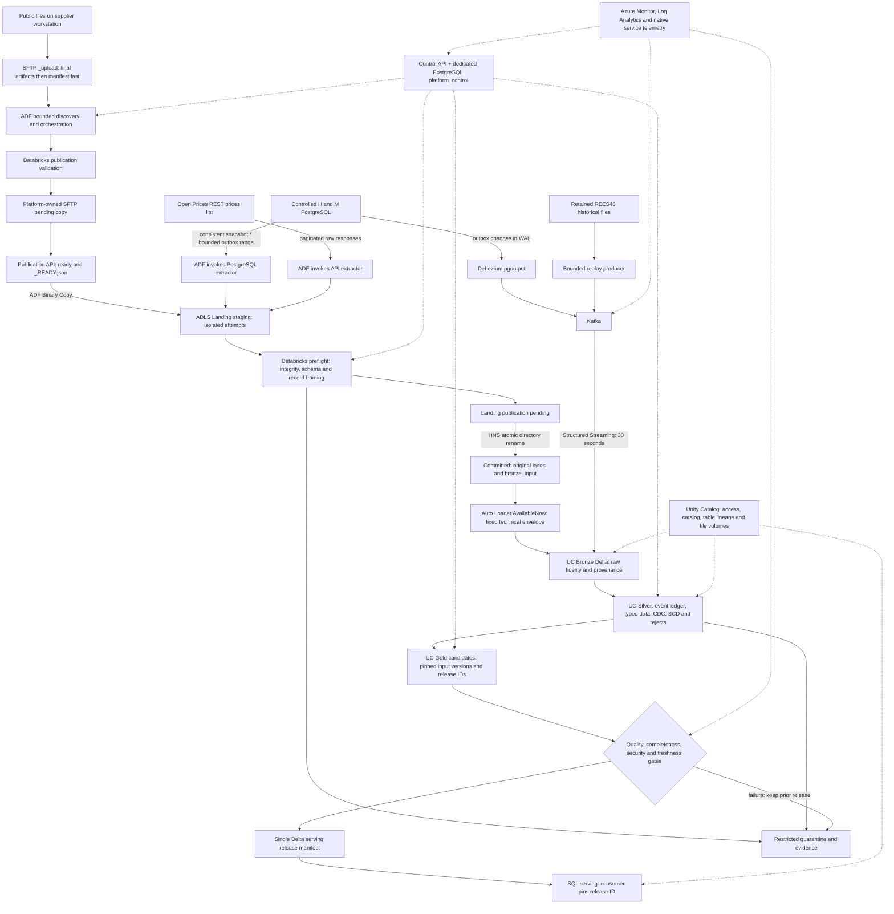
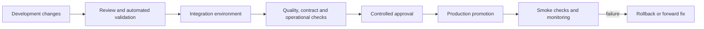

# Enterprise Azure Databricks Architecture — Audited Established Proposal

**Revision:** 2026-10-13; baseline is user annotation 1. **Authority:** one consolidated architecture at this existing file path. **Implementation:** design verified where stated; implementation not yet tested. **Deadline:** October 18,2026 23:59 IST; working dates13/15/16/17/18. No commit/push or Azure changes in this task.

## 1. Audit the established proposal and preserve its valid decisions

**Baseline:** the complete proposal quoted in user annotation 1, source message msg_05f5615d4978870c016acdea406c1487d0a7f7f795e8b76a47. The annotation reproduces the original proposal and is the recoverable pre-revision version. The older GitHub architecture is historical context, not the baseline being audited. Its clean tracked-file snapshot at b1905f3 was separately archived before documentation edits at C:/Users/harsh/AppData/Local/Temp/azure-retail-architecture-before-audit-b1905f3.zip (SHA-256 D67A1A223706A4FED7318F5C37D7B1AD471BD572A5C3222E235FF2BE790B1C8B); it is not substituted for the annotated proposal.

**Status:** revised implementation specification. Design verification is distinct from deployed/tested behavior. No application code, infrastructure, cloud resources, notebooks or pipelines are implemented by this task.

Retained exactly at architectural decision level: selected datasets; Mongo/Cosmos exclusion; Prices endpoint correction; one OFF logical contract/three deliveries; verified WC weather layouts; mandatory Azure/ADF/Databricks/PySpark/Auto Loader/Delta; 26-table transactional PostgreSQL control/API design; fixed technical Bronze envelopes with original bytes; WAL outbox capture; 30s streams; source schedules and C/B/S/G budgets; one serving release pointer; versioned reusable package and deployment; five active days with October 14 paused.

The original proposal already corrected legacy repository inconsistencies. This audit does **not** present those old errors as gaps in the annotated baseline.

| Annotated baseline mechanism | Audit result | Integrated refinement |
|---|---|---|
| Shared platform and source inventory | Correct; retained | Explicit source/target entity mapping and migration aliases |
| Consistent four-table PostgreSQL extract | Partially specified | Shared exported/imported REPEATABLE READ snapshot, bounded workers, token-loss recovery |
| Lock before outbox sequence allocation | Correct; retained | Restricted writer interface, rollback-gap handling, no-skip proof and concurrency test |
| Common event_id for batch and WAL capture | Correct; retained | One Silver coordinator, baseline high cut, transaction-group coverage, source generation and conflict handling |
| Source-preserving technical envelopes | Correct; partially specified fidelity | Exact CSV/JSON lexemes, DAT headers and deterministic Parquet raw references/type tags |
| Pending→committed publication | Correct; retained | Conditional HNS directory publish, independent SQL acknowledgment repair and late-source handling |
| Fixed-schema Auto Loader | Correct; retained | Explicit rescue/corrupt-envelope gate, transaction-retention/restart-generation policy |
| Gold release pointer | Correct; consumer semantics incomplete | One Delta manifest + immutable candidates; client pins one release across multiple queries |
| Transactional control/API and 26 logical tables | Correct; retained | Revision-safe enforced keys, API idempotency, evidence authority, no claim SQL leases fence Delta |
| Layer-specific DQ | Partial | Versioned rules with owners/thresholds/dispositions/evidence/tests and conserved accounting |
| Reject/quarantine/replay | Partial | Actual file/Delta/DLQ storage, authorization, durable lifecycle and failed-replay continuation |
| Unity Catalog/security/lineage | Partial | Concrete catalogs/schemas/volumes/grants, masking fallback, custom provenance and retention/audit boundaries |
| API resume | Partial source guarantee | No mixed enumeration attempts; observation rather than invented historical change/delete completeness |
| Recovery targets | Correct targets; deployment conditional | Backup prerequisites, checkpoint-loss and source-generation resynchronization, measured RPO/RTO |
| Deployment and test framework | Correct; retained | Explicit migration/canary/rollback and cross-layer failure-injection acceptance procedures |

The revised sections below integrate these refinements into the same proposal. Older implementation files remain historical until the documented migration is implemented; their existing rows and original bytes are preserved.

## 2. Use the established single platform architecture

The established Azure/ADF/Databricks/PySpark/Auto Loader/Delta architecture remains the foundation. Public datasets are bootstrapped into controlled boundaries, batch inputs pass staging and committed Landing, streams enter raw Bronze directly, Silver establishes trusted domain data, and Gold publishes quality-gated releases. Governance and recovery apply at every boundary.



The Control API and Publication API are two authorized functions in one Azure Function application; they are not additional orchestration engines. Control SQL enforces operational uniqueness/transactions. Data remains in ADLS/Delta. There is no distributed transaction spanning SQL, ADLS, Kafka and Delta. Each boundary uses durable evidence, deterministic identity, conditional publication and reconciliation.

## 3. Keep the selected datasets and source-to-target mappings

Public source data and controlled source simulations remain distinguished. No new dataset is added. OFF's three physical entity IDs are delivery aliases under one logical products entity/contract; existing alias records are preserved and mapped, not three independent business entities.

| Source / selected artifacts | Controlled boundary | Modes and source truth |
|---|---|---|
| H&M articles.csv, customers.csv, transactions_train.csv | PostgreSQL retail_src tables | One consistent initial snapshot; scheduled outbox extraction; actual WAL CDC of the same transactional outbox. Later CUD is project simulation, not historical retailer changes. |
| H&M sample_submission.csv | PostgreSQL retail_src.sample_submission | Initial-only static reference; no CDC or incremental schedule |
| REES46 2019-Oct/Nov/Dec and 2020-Jan/Feb/Mar/Apr.csv.gz | SFTP, one immutable monthly delivery each | Historical CSV/GZIP batches; all seven months required for a complete historical-period product |
| Open Food Facts openfoodfacts-products.jsonl.gz | Three record-boundary SFTP JSONL parts | One logical contract contract_off_products_v1; three physical deliveries with one source-version/snapshot group |
| Amazon raw_meta_Electronics | Ten Parquet artifacts in one SFTP delivery | Metadata snapshot; all ten files required |
| Amazon Electronics.jsonl | Separate SFTP delivery | Reviews snapshot; parent_asin joins metadata within Amazon only |
| WC_F_2016.zip, seven DAT artifacts | SFTP | TOA5 weather data, comma-quoted text, four header rows; multiple verified layouts. Existing ent_wc_store_sales and contract_wc_store_sales_v1 are retained technical IDs, not claims that data contains store sales. |
| Open Prices GET /api/v1/prices | HTTPS extractor invoked by ADF | Raw paginated responses in Landing; creation-window capture plus recurring current observations, not guaranteed API CDC |
| REES46 historical replay | Kafka producer from retained historical files | Controlled streaming simulation, not live source; deterministic source record IDs shared with batch |

MongoDB dump/Cosmos and the Open Food Facts Product API are not active project sources. Their obsolete entries are corrected, not replaced by another dataset. The OFF JSONL source remains.

**Verified local evidence:** WC_F_2016 contains seven UTF-8 DAT artifacts and 45,438 data records excluding the four header rows per artifact. Column-name layouts have 20 (T107), 20 (T109), 21 and 27 fields. Existing WC 27-field metadata covers only BLTA; pipe/23-field assumptions are invalid. Station metadata, units and aggregation headers are retained per artifact. Timestamp timezone and sentinel interpretation are not proved by the files and must not be guessed.

**Expected, not independently recounted here:** H&M counts in the repository are articles 105,542; customers 1,371,980; transactions 31,788,324; sample submission 1,371,980. Full-file profiling verifies these before snapshot admission. Public versions/hashes, license/attribution, actual compressed/uncompressed sizes, source URLs and retrieval timestamps are recorded before bootstrap.

There are no business joins between H&M, REES46, Amazon and weather. OFF/Open Prices joins require matching product_code plus product_code_source, preserving leading zeros and unmatched observations. Amazon joins use parent_asin; missing metadata is a measurable exception, not silently discarded.

### 3.1 Authoritative mapping

Identifiers already established are retained unless a source-semantic error requires a versioned migration. Schema/table names below are qualified by retail_de_{env}.

| source_id / entity_id | Physical source → extraction / capture | Landing / Bronze target | Silver → Gold handoff |
|---|---|---|---|
| src_hm_postgresql / ent_hm_articles | articles.csv→retail_src.articles; initial snapshot + daily outbox extraction | canonical staging→committed; bronze.hm_articles (snapshot + outbox envelopes) | hm_change_ledger + articles current/history→H&M products |
| src_hm_postgresql / ent_hm_customers | customers.csv→retail_src.customers; same initial + daily modes | bronze.hm_customers | Customer current/history→H&M products |
| src_hm_postgresql / ent_hm_transactions | transactions_train.csv→retail_src.transactions with generated SHA-256 transaction_id; initial + hourly outbox | bronze.hm_transactions | Transaction current/delete state→H&M products |
| src_hm_postgresql / ent_hm_sample_submission | sample_submission.csv→static table; initial only | bronze.hm_sample_submission | Static reference; no fabricated purchase facts |
| src_hm_postgresql / three mutable entities, CDC pipeline | WAL of same transactional outbox→Debezium→{env}.hm.changes.v1 | No file Landing; bronze.hm_cdc_events raw Kafka/Debezium | Same shared event ledger/coordinator as batch; event_id common |
| src_rees46_sftp / ent_rees46_events_batch | Seven named monthly CSV/GZIP packages→SFTP→ADF Binary Copy | canonical staging/committed original + bronze_input; bronze.rees46_events_batch | Shared REES source record ledger→events/sessions/funnel |
| src_openfoodfacts_sftp / ent_off_products_part_001/002/003 | Three line-boundary JSONL physical parts, one source snapshot group | Each physical delivery to bronze.off_products_jsonl; one logical products contract | OFF selected group/current observations→Prices/OFF product |
| src_amazon_electronics_sftp / ent_amazon_electronics_metadata | Ten typed Parquet artifacts in one atomic package | bronze.amazon_electronics_metadata | amazon_products; parent_asin join validation |
| src_amazon_electronics_sftp / ent_amazon_electronics_reviews | Electronics.jsonl separate package | bronze.amazon_electronics_reviews | amazon_reviews→review metrics |
| src_legacy_dat_txt_sftp / ent_wc_store_sales | Seven WC_F_2016 TOA5 DAT artifacts, registered layout per artifact | bronze.wc_f_2016_raw technical envelopes with original text/header references | wc_observations/measurements→weather metrics |
| src_open_prices_api / logical Prices entity | GET /api/v1/prices bounded raw response pages; ADF invokes extractor | bronze.open_prices | Open Prices observations/current→matched price observations |
| src_rees46_kafka_replay / ent_rees46_events_stream | Deterministic REES file record replay→{env}.rees46.events.v1 | No file Landing; bronze.rees46_events_stream | Same REES record ledger, no duplicate batch contributions |

The existing ent_open_prices_proofs_drafts registry/field set describes proofs, not prices. This is a **required versioned source-semantic correction**: retain original rows/history inactive, register ent_open_prices_prices and its profiled /prices contract/mapping, migrate that source's pipeline activation and Bronze/Silver routing, and never relabel proof fields as price fields. No new public dataset is introduced. OFF part mappings are completed so all three physical entity IDs point to contract_off_products_v1; parts do not create extra business contracts.

### 3.2 Source contracts

Common immutable header: source/entity scope, version/status/effective interval, owner/approval actor/time, source version/provenance, physical schema/layout, field definitions and semantic types, keys/identity policy, encoding/format/compression, parser behavior, cadence/window, SLA/SLO, completeness/control totals, schema evolution, correction/replay, classification/license, retention, acknowledgment and escalation. Pinned contract versions never change mid-run.

| Entity group | Completeness and schema authority | Required source-specific contract controls |
|---|---|---|
| H&M initial, four entities | Frozen source generation, imported export snapshot, baseline H, per-range counts/keys/control totals | Source CSV hashes/ordinals, generated key spec, nullable/decimal fields; all four tables same group; sample initial-only |
| H&M incremental + CDC | Outbox schema, event_id, sequence/generation, transaction group/expected event count | CUD+outbox atomic, serialized lock before allocation, direct writes forbidden; batch source bounds vs native WAL/transport positions |
| REES46 batch/replay | Same profiled nine-field schema, immutable month version/hash + logical ordinal | CSV quote/header/UTF-8/GZIP, parsed count excluding header; replay event_uid, historical timestamp and producer rate; seven-month coverage |
| OFF products | Single contract_off_products_v1 and qr_off_part_001_schema_v1 across three parts | Split on full JSONL records, independent compressed streams, source group/part indices 1–3, namespace keys, union of observed nested structure, malformed-line raw policy |
| Amazon metadata | Parquet footer/type profile; ten artifact inventory | parent_asin string, nested field types, decimal/string price preserved; row-group references; one atomic metadata version |
| Amazon reviews | JSONL field profile and raw per-record references | Parent key, timestamp/rating/text validation; no unsupported unique review key |
| WC DAT | Existing contract_wc_store_sales_v1 ID retained; layout-scoped fields and source facts reviewed | Four TOA5 headers, comma quoting, UTF-8, four column-name layouts, artifact station/units/aggregation, data/header counts, timezone unknown where not established |
| Open Prices | Inspected /prices response and request schema, not proof drafts | page/size/order/filter capabilities, HTTP/count bounds, max pages budget, observation semantics, 429/retry, no guaranteed historical update/delete capture |

Source schemas are contractual definitions stored in source_contract_field and immutable schema_version snapshots. Observed delivery schemas are separate snapshots; automatic inference cannot activate a business contract. The project owner simulates source/steward approval from actual profiling rather than claiming an external source team exists.

## 4. Preserve the downstream domain products and metric semantics

Gold contains governed domain models and analytics-ready products. It does not invent cross-domain keys.

Examples of valid domain work include:

- H&M customers, articles, and transactions joined using their documented identifiers for customer, product, and transaction analysis.
- REES46 event unions and session, product, funnel, and time-window aggregates within the event domain.
- Amazon review and product metadata analysis where identifiers are actually compatible.
- Open Food Facts products joined to Open Prices records by a documented barcode or product code, preserving leading zeros and isolating unmatched records.
- Supplier-file products joined to an approved product mapping only when the controlled seed data establishes a defensible mapping.

Gold products include freshness, source coverage, quality status, and lineage metadata so consumers can distinguish a complete result from a partial or quarantined run.

### 4.1 Governed data products and definitions

| Product / Gold targets | Grain and input dependencies | Metric and publication rule |
|---|---|---|
| hm_daily_sales, hm_article_customer_metrics | transaction date/channel/article; pinned H&M baseline or fully reconciled change cut | Transaction count and sum of dataset-normalized price; do not label monetary revenue or assume currency. Historical dimension join uses validated SCD intervals; no fan-out or missing FK. |
| rees46_daily_funnel, rees46_session_metrics | business event date/event type/session in REES46 only | View/cart/purchase counts and session conversion, each record_uid once. Full-period report requires all seven months. Late correction recomputes affected sessions/dates. |
| amazon_product_review_metrics | parent_asin and declared review period | Rating count/sum/average from valid ratings; metadata max one row per selected product version. Unknown products exposed as unmatched. Do not invent a stable review ID. |
| off_price_observations | product code + namespace, business date, currency/location | Match OFF selected version to observed prices; no sum across currencies, no claim of full global market coverage or source CDC. |
| wc_station_daily_measurements | station, local source date, measure, unit/layout | Weather counts/min/max/mean over valid comparable measurements; ambiguous unit/timezone exposed and excluded from incompatible aggregation. |
| platform_ingestion_health | source/entity/layer/window/product | Timeliness, count coverage, quarantine and incident scorecards, not job-success-only reporting |

Each product registers owner, descriptions, grain, dependency coverage, metric version, valid date/window, quality thresholds, classification and consumer contract in metadata.data_product. Source/dimension cut and selected schema versions must be in the release manifest. Aggregates use exact counts/sums at matching grain, not sums of averages. Delete/update corrections recompute impacted keys/date partitions from authoritative Silver; replay cannot add a second contribution.

## 5. Preserve source schedules and processing budgets

All times UTC; IST is UTC+05:30. Preserve these previously reviewed schedules and stage budgets. Durations are budgets, not fabricated observed run times. Source-ready/extraction start→committed is Landing budget; committed→reconciled Bronze is Bronze budget; then Silver and Gold budgets apply sequentially. A downstream product deadline includes all dependencies and the actual latest source availability.

| Entity / mode | Availability / extraction trigger | Landing budget | Bronze budget | Silver budget | Gold budget |
|---|---|---:|---:|---:|---:|
| H&M four-table initial | Once per source generation; manual after seed/freeze/slot readiness | 4h | 2h | 2h | 30 min |
| H&M articles incremental | Controlled changes available before daily 00:30 | 15 min | 10 min | 10 min | 5 min |
| H&M customers incremental | Daily 00:30, same schedule | 15 min | 10 min | 10 min | 5 min |
| H&M transactions incremental | Hourly HH:15 bounded committed cut | 20 min | 10 min | 10 min | 5 min |
| H&M three-entity CDC | Continuous during enabled simulation hours; Spark 30s trigger | N/A | p95 ≤5 min from trustworthy source commit | End-to-Silver p95 ≤5 min | End-to-Gold p95 ≤10 min |
| H&M sample submission | Initial only | Included in initial group | Included | Reference only | No independent incremental product |
| REES46 seven monthly batches | Bootstrap bounded manual months; operating simulation first day 00:00–02:00; scan 5 min | 90 min per ready delivery | 60 min | 60 min | 30 min |
| OFF products, three parts | Daily window 02:00–03:00; parts 02:00/02:20/02:40; scan 5 min | 90 min each | 60 min | 60 min after group complete | 30 min |
| Amazon metadata | Sunday 03:00; ten artifacts complete before readiness | 60 min | 30 min | 30 min | 15 min |
| Amazon reviews | Daily 03:30 | 180 min | 120 min | 120 min | 30 min |
| WC_F_2016 | First day monthly 04:00–05:00; pilot/manual bootstrap; scan 5 min | 30 min | 15 min | 15 min | 10 min |
| Open Prices | Daily 03:05; Sunday full observed-state reconciliation also 03:05 | 120 min | 30 min | 30 min | 15 min |
| REES46 Kafka replay | Manual bounded historical run; producer rate bounded; Spark 30s | N/A | p95 ≤5 min from simulated publish | End-to-Silver p95 ≤5 min | End-to-Gold p95 ≤10 min |

Gold batch refresh is dependency-driven; enabled CDC/replay product refresh runs every five minutes, with the established end-to-Gold p95 ≤10 min target. A fresh process timestamp cannot hide an older input cut.

Batch product freshness bound = schedule interval + source availability delay + all dependency stage budgets; articles daily completion target 01:10 when extraction starts at 00:30; transactions the following hour at :00 on-time start when required dependency cuts are available, not an hourly five-minute freshness promise. CDC provides the low-latency H&M change path. Reference dimensions and CDC transaction groups must be consistent for Gold publication. WC source event dates remain historical; technical freshness measures the simulation delivery, not weather recency.

ADF hourly late-arrival sweeps continue for seven days beyond the declared window; missing expected deliveries create an incident at window close. A valid late revision can pass gates and restate products, visibly late. Bootstrap large files use manual bounds and the same budgets; measured throughput/quota can establish a breach, never justify marking a sample as a full source load. Section17.3 defines SLO measurement; 17.6 defines RPO/RTO.

## 6. Retain the transactional control plane and26-table model

The annotated baseline decision to put transactional operational state in a dedicated Azure Database for PostgreSQL database **platform_control** is retained and specified. It is physically separate from the controlled H&M source server/database to avoid a source outage stopping its incident/recovery authority. One authenticated Control API is the only operational-state writer; reviewed migrations manage metadata versions. There is no assumption that Databricks SQL Editor is a storage system.

The 22 existing tables in the workbook are useful metadata/evidence schemas; their seven populated metadata tables (13 entities, 11 rules, 11 schemas, 7 sources, 11 contracts, 179 fields, 11 mappings) are imported only after validation. The 14 runtime tables and schema_drift_event are empty in the export. These counts are export evidence, not live Azure verification. Delta PK/FK/unique declarations are not enforced relational locks. The control-table migration is necessary for concurrent transactional admission and revision-safe uniqueness, not a demand to repeat all dataset registration manually.

| Authority | Owns | Does not own |
|---|---|---|
| Git reviewed specifications | Contracts, mappings, rules, IaC, job/ADF definitions and release code | Live run progress |
| PostgreSQL platform_control | Enforced keys, active metadata versions, delivery/run state, leases, batch/API cursors, recovery authorization | Kafka Connect offsets or Delta commits |
| Delta transaction log | Actual table commit/version and serving_manifest | Multi-system transaction |
| Auto Loader / Spark checkpoint | Discovered files, microbatch/source progress and stream state | Approved business schema |
| Kafka Connect durable offsets/slot | Connector source restart positions | Silver/Gold progress |
| Unity Catalog | Governed assets, grants, descriptions, table/column lineage where captured | All external operational lineage or source-system ACLs |

UC Delta tables in metadata/ops/landing_audit/dq/quarantine become read-only governed projections of platform_control for reporting; each carries export_watermark. The API never writes both stores and calls that atomic. Raw exception payloads stay in restricted UC Delta/file storage; operational SQL stores references/redacted diagnostics. Existing Delta definitions remain historical artifacts and are not executed as the new control plane.

The canonical physical specification, preserved columns, additions, enforced PK/UK/FK/index rules, migration and ownership are in [control tables.md](../../control%20tables.md). It specifies 26 logical control tables: the original inventory with asset_commit generalizing bronze_commit plus pipeline_config, data_product, asset_dependency and product_release. Historical bronze_commit exports remain available and map into asset_commit; no evidence is deleted.

Every operational row has env and row_version where mutable. Source/entity IDs remain global logical IDs with environment-qualified registry keys. Runs pin contract/mapping/rule/pipeline/code/source-generation versions; activation never mutates those pins. Cursor advancement and run-state change use SQL compare-and-set transactions. Publication operations bind request idempotency key, current lease epoch and manifest hash.

A SQL lease cannot prevent a stale Spark executor writing Delta. TTL expiry triggers SUSPECT_OWNER; admission remains blocked until the Jobs API confirms old run termination and no active target writer. New owners write an isolated candidate generation; only the current fenced owner can publish. Direct Gold consumers see only the serving manifest, not losing candidates. Required asset evidence and recovery procedures are in Sections 16.1 and 16.4.

### 6.1 Logical inventory and important enforced keys

| Schema | Tables | Important enforced grain / authority |
|---|---|---|
| metadata | source_config, entity_config, source_contract, source_contract_field, source_mapping, schema_version, schema_drift_event, quality_rule | Env-qualified IDs/versions; immutable contract fields keyed by version/layout/path; observed schemas do not change approval |
| metadata | pipeline_config, data_product, asset_dependency | Mode/config version; product/grain/metric version; declared dependencies/column mappings |
| landing_audit | source_delivery, delivery_manifest, delivery_artifact, validation_result | Delivery_version_id and unique source/entity/ID/revision; manifest hash; delivery/path; execution/rule/version |
| ops | ingestion_run, run_step, run_event, cursor_state, work_lease | Request-idempotency key; step/subject/attempt; append events; pipeline/progress domain/partition cursor; unique work scope and epoch |
| ops | asset_commit, product_release | Target/generation/input identity commit; immutable release ID/native manifest evidence |
| ops | recovery_request, alert_event | Authorized bounded correction/replay request; open incident dedup key |
| dq | reconciliation_result | Layer/grain/input-version-aligned control totals |
| quarantine | quarantine_event | Original identity/stage/rule/version plus correction/recovery lifecycle |

The model remains26 tables: no table per parameter or per datasource. Snapshot tracking is source_delivery.snapshot_group_id plus run bounds; API requests/pages are cursor/artifact evidence; stream commit ranges are asset_commit/native checkpoints. Existing bronze_commit is migrated into asset_commit with layer=BRONZE and preserved historical references. Full physical specification is maintained in control tables.md, updated as an implementation dependency of this same architecture, not a competing design.

## 7. Retain source-faithful Bronze records and deterministic technical identities

Bronze is Delta Lake’s raw, replayable ingestion layer. It preserves source fidelity while adding technical metadata required for operations.

Each record or event carries, where applicable:

- Source and entity identifiers.
- Ingestion run, batch, file, Kafka topic, partition, and offset metadata.
- Source event time and ingestion time.
- Schema or contract version.
- CDC operation, transaction metadata, and event identity.
- Raw payload or source columns with minimal normalization.
- Quarantine reason or parse status for records not eligible for the valid Bronze path.

Bronze writes are idempotent using deterministic source identities and transactionally committed Delta operations. Checkpoints, commit versions, and run metadata make the layer restartable and auditable.

### 7.1 Source fidelity and the stable technical envelope

The established baseline's deterministic record framing is retained. Preflight creates bounded JSONL bronze_input chunks while retaining original bytes; Auto Loader reads these envelopes. Framing is technical ingestion, not a business transformation. No joins, business deduplication, revenue/currency normalization, imputation, sentinel conversion or aggregation is permitted here.

Common envelope v1: envelope_version, record_uid, source_id, entity_id, source_version, delivery_version_id, artifact_uid, record_ordinal, record_kind, contract_id/version, observed_schema_version_id, layout_id, payload_format, raw_payload, raw_reference, parse_status, validation_status, source_event_time (nullable), extracted_at and payload_sha256. Bronze appends ingestion_time, pipeline_id, run_id, microbatch_id, target_generation and code_version. A null source event timestamp is explicit; extraction time must not masquerade as source commit time.

- CSV: preserve original decoded logical record including quotes/escaping; assign a deterministic logical ordinal including legitimate repeated rows. Header bytes remain in original. Multi-line CSV is counted by the contract parser, not newline count.
- JSONL: retain original line, including malformed lines; keep original file bytes for exact encoding/line-ending reconstruction. Do not round JSON numeric lexemes before raw preservation.
- DAT: retain all four TOA5 header rows as HEADER records and each data row as DATA with physical line number and layout/station headers. Reconciliation separates header and data counts.
- Parquet: original file hash plus row-group and row index is the stable raw reference. Canonical row serialization is tagged with source types (decimal precision/scale, binary base64, timestamps) and is not falsely called byte-identical Parquet. If the selected framer cannot produce stable row positions/tagged values, block that adapter's publication; do not substitute unstable Spark monotonically_increasing_id.
- PostgreSQL: snapshot_id, baseline_high, source_generation, source key and original scalar/type representation accompany rows. Incremental payloads carry event_id, change_seq, source_transaction_id, transaction_event_count/ordinal, operation and before/after.
- API: retain entire HTTP response bytes with request/attempt/page/retrieval metadata; item envelopes reference page hash plus item identity/position.
- Kafka: raw key/value BINARY, topic, partition, offset, broker timestamp and headers are stored before decoding; source event metadata is extracted without discarding original bytes. Tombstones have null value and record_kind=TOMBSTONE, not malformed-empty JSON.

record_uid = SHA-256(artifact_uid + deterministic logical ordinal), except H&M changes use source_generation + event_id and REES replay preserves its batch source record_uid. artifact_uid includes immutable source version, artifact role/path and content hash; replay/correction run IDs are lineage, not replacements for business identity. A corrected source version is new raw evidence with supersedes linkage.

### 7.2 Commit, quality and progress

Normal file capture has one writer/checkpoint per pipeline/environment/target generation. foreachBatch writes use stable txnAppId and batchId as txnVersion; a fresh checkpoint has a new app ID. Exact technical row counts, distinct record identities, metadata completeness, envelope validity and raw-reference integrity gate capture reconciliation. Source malformed records with recoverable boundaries remain in raw Bronze with status; malformed **platform envelopes** fail the task.

Delta commit evidence is authoritative for data durability. A missing SQL acknowledgment after Delta success is repaired from commit/run metadata and identity reconciliation; it does not justify another unguarded append. Batch cursor advances after Bronze capture reconciliation. Separate Silver/Gold processing progress advances after their own gates; a downstream failure does not rewind already captured source data.

Source-to-Bronze accounting: declared parsed source records = unique DATA envelopes + captured malformed source records; header/control records are accounted separately. Duplicate capture identities do not erase repeated source content with different ordinals. No source record is silently dropped.

## 8. Use the established file-delivery lifecycle and publication boundaries

ADLS Gen2 Landing is the immutable source boundary. It stores original extracted bytes or raw API responses together with operational metadata. Streaming CDC and REES46 replay intentionally bypass file Landing.

```text
sftp/_upload/{env}/{source_id}/{entity_id}/{delivery_id}/revision={revision}/
sftp/_publish_pending/{env}/{source_id}/{entity_id}/{delivery_version_id}/
sftp/ready/{env}/{source_id}/{entity_id}/{delivery_id}/revision={revision}/
sftp/rejected/{env}/{source_id}/{entity_id}/{delivery_id}/revision={revision}/
landing/staging/{env}/{source_id}/{entity_id}/{delivery_version_id}/attempt={attempt}/
landing/_publish_pending/{env}/{source_id}/{entity_id}/{delivery_version_id}/
landing/committed/{env}/{source_id}/{entity_id}/{delivery_version_id}/
  original/                  # unchanged source bytes / raw response pages
  bronze_input/               # deterministic technical envelopes
  manifest.json
  _COMMITTED.json
checkpoints/{env}/{pipeline_id}/{target_generation}/checkpoint/
quarantine/{env}/{source_id}/{entity_id}/{reason_code}/{run_id}/
```

delivery_version_id identifies (env, source, entity, delivery_id, revision) unambiguously. Existing data is not moved in this documentation task; migration maps historical path aliases to canonical references without modifying original objects.

Preflight reads staging **without write permission**, checks destination checksums/counts and contract, and writes verified originals plus envelopes to publication pending. Publication API performs conditional HNS directory rename into committed within the same filesystem. It is not dbutils.fs.mv copy/delete. No copied artifact is exposed incrementally within the watched prefix. Destination exists with equal manifest/content identity is an idempotent success; differing content is DUPLICATE_CONFLICT. _COMMITTED.json is evidence created in pending before rename; readers do not rely on Auto Loader honoring a completion marker.

One committed delivery can be captured to Bronze before all parts of its OFF snapshot group are available; Silver/Gold publication requiring that source version waits for all three parts. Amazon metadata's ten files are one indivisible package. Supplier acknowledgments follow durable committed evidence and include accepted/rejected identity and checksums; an acknowledgment failure retries the acknowledgment, not extraction. Source cleanup is disabled during the project and subject to the retention/recovery gates in Section 17.2.4.

### 8.1 Supplier manifest and platform publication contract

Manifest v1.0 is a UTF-8 JSON object; manifest_version is TEXT, contract_version retained as text, byte/count values integers, SHA-256 normalized lowercase 64 hex. It contains delivery_id/revision/type, source/entity, source_version, optional snapshot_group_id/part_index/expected_parts, contract_id/version and schema/layout references, producer system/batch/finalized_at, bounded source window/business date, package_complete/source_window_final, expected artifacts/count method, and artifact entries (sequence, safe relative path, name, format, compression, encoding, parser/layout reference, exact size, exact compressed-byte checksum, parsed data-record count/header accounting). Created-at timestamps are evidence, not content-completeness proofs. All dates ISO8601 UTC where UTC is known; source-local weather timestamps remain source-local.

The received supplier manifest is immutable. Platform observed sizes/hashes/counts/schema snapshots and decisions are stored separately. _READY.json contains delivery_version_id, manifest hash, validation evidence IDs, platform actor/run/time and published inventory. _COMMITTED.json additionally identifies envelope version/output chunks, source checksums, contract/mapping/rules and raw count controls. Supplier writes neither marker.

Readiness states: manifest absent/pending transfer→wait; manifest malformed/identity violation→reject; files changing/missing inside window→wait; stable mismatched bytes/hash/count or unlisted files→reject; complete platform-owned copy→ready. Deadline miss→TIMED_OUT incident, not automatic destruction/quarantine of an active upload. A signed/trusted producer control count is still needed to distinguish a full file from a self-consistent truncated export. For this simulation bootstrap source count/hash is the independent baseline.

## 9. Make readiness, deadlines and source acknowledgments distinguishable

Supplier receives a platform-assigned ULID and revision=1 before upload. It finalizes the local source package, calculates manifest values over exactly those bytes, uploads data as .partial, explicitly renames each completed file to its final name, uploads manifest.json.partial and renames it to manifest.json last. Renaming is a supplier client action, not SFTP automatic behavior. A correction uses the same delivery_id with a higher immutable revision.

The Databricks publication validator, invoked by ADF, checks manifest syntax, assigned identity, authorized source/entity/path, active contract, complete/final indicators, exact artifact list, format/compression/encoding, byte sizes, SHA-256, parsed counts and multipart membership. It copies into platform-owned pending space and validates that copy before the Publication API publishes ready and writes _READY.json. The supplier cannot write ready/rejected or change that platform copy. Stability sampling is a race detector, not proof of completeness; SHA-256/count versus a trustworthy manifest supplies integrity, and independent export/source counts supply completeness.

ADF copies only platform-published ready packages into isolated staging attempts. Schema compatibility is assessed in staging against the pinned contract; basic wrong-format/layout identity is checked earlier. Full validation happens before committed publication; Auto Loader is not the first schema gate. Transient transfers retry without quarantining sound data. Late deliveries open incidents but can still pass normal gates. Stable wrong hashes/inventory are rejected; active uploads remain pending. A wrong file and a self-consistent wrong manifest need independent dataset/schema/source controls to detect them.


After a sound platform-ready package exists, the supplier acknowledgment is a separate durable operation. An acknowledgment timeout retries that receipt only; it does not cause another publication/extraction. Source cleanup remains disabled during the project; retention deletion requires successful capture plus verified recovery coverage. Unknown source errors fail safely with raw evidence and are classified before progress advances.

## 10. Coordinate PostgreSQL initial snapshot, incremental extraction and WAL CDC

### 10.1 Initial and incremental transactions

Seed and validate the four selected H&M files. Articles/customer IDs remain strings; transaction_id is SHA-256(source-file SHA-256 + deterministic logical row ordinal), preserving legitimate duplicate purchases. Bootstrap provenance and generated keys are explicitly project metadata.

All mutable-source writes use one controlled database write interface. Direct CUD/TRUNCATE/DDL by the mutation identity is denied. That interface takes a common transaction-scoped advisory lock **before any sequence allocation**, modifies the source, and appends all before/after outbox events in the same transaction. It holds the lock through commit/rollback. Outbox fields are specified in 10.3. This project deliberately serializes mutation commits to obtain a provable safe extraction high bound; it is not a generic claim about PostgreSQL sequences.

Initial extraction pauses mutations and drains active transactions, establishes one REPEATABLE READ READ ONLY coordinator transaction, exports its snapshot and imports that snapshot into each worker before the worker's first query. The coordinator stays open until extraction finishes. The PostgreSQL/API extractor is a separate job/runtime role from Bronze ingestion. It writes isolated staging files using the Azure Data Lake SDK authenticated as a dedicated Azure extraction principal with path ACLs restricted to staging; its credential is fetched in memory from Key Vault and never supplied in job parameters. The dedicated Bronze ingestion Access Connector stays staging-read-only. Native SDK writes, like ADF Copy, are governed by Azure IAM/ACL and custom provenance; registering staging in UC does not claim UC enforces those external writes. Do not create overlapping UC external locations or misuse a UC service credential as a storage credential to solve this distinction. ADF independent Copy queries or Spark parallel JDBC connections do not automatically share that snapshot. The custom extractor configures every worker transaction. At most two workers execute bounded key ranges; manifests record range coverage and counts. If the coordinator dies, the exported token cannot be reused: while the source remains frozen and its identity/count controls match, start a new exported snapshot attempt in the same logical group; otherwise abort the group and start a new baseline. No mixed snapshot fragments.

Incremental extraction pins (committed low, observed committed high], entity, source generation and schema/mapping versions. It reads outbox events, including deletes, ordered by change_seq and event_id. Zero qualifying events is NO_CHANGE and permits a reconciled cursor advance. Retries keep the identical bounds. The old preceding-100 overlap is removed: it cannot establish safety for arbitrarily late commits. The serialized writer protocol proves that no transaction can commit a previously invisible smaller sequence after a visible high sequence. Rolled-back sequence gaps are legal; completeness is actual source count/event IDs, not high minus low.

### 10.2 PostgreSQL CDC

Debezium reads actual PostgreSQL WAL for retail_ops.incremental_outbox using pgoutput. The same event_id/change_seq appears in incremental extracts and WAL envelopes. This preserves real WAL CDC while solving cross-mode identity. The connector retains raw Debezium source/transaction metadata; it does not discard LSNs by an unverified unwrap transformation.

Before resuming mutations: create/validate the publication and one persistent slot, start the connector with snapshot.mode=no_data after verifying the pinned Debezium version supports it, verify offsets/slot health, complete and reconcile the initial source snapshot through Silver, set baseline high H, then resume CUD. Events at or below H are baseline-covered; events above H enter the shared Silver event ledger. Batch and CDC Bronze remain separate capture evidence; **one Silver coordinator** applies their union by common event_id, sequence and source generation. Sample submission is excluded.

Continuous Spark trigger is 30 seconds. A malformed event or tombstone is captured in raw Kafka Bronze before classification/DLQ export. A PostgreSQL source DELETE is an outbox application event with operation=DELETE, not the Kafka compaction tombstone. Tombstones do not trigger deletion unless the application event proves it. Slot/offset loss invokes explicit gap recovery, never silently starts from latest.


### 10.3 Source identities and no-skip proof

Source-generation ID changes only for reseed/rebaseline. Source keys: article_id, customer_id and generated transaction_id TEXT with a 64-hex-character SHA-256 check. sample_submission key candidate customer_id is verified before enforcement. Do not retain the obsolete BIGINT transaction-ID assumption.

Outbox columns: change_seq BIGINT, event_id UUID, source_generation UUID, entity_name TEXT, aggregate_key TEXT (entity + canonical PK), operation TEXT CHECK INSERT/UPDATE/DELETE, source_primary_key_json JSONB, before_payload_json JSONB nullable, after_payload_json JSONB nullable, source_transaction_id TEXT (project-assigned transaction UUID for cross-mode grouping), transaction_event_count INT, transaction_event_ordinal INT, schema_version TEXT, event_created_at TIMESTAMPTZ, is_simulated BOOLEAN. PK event_id, UNIQUE(source_generation,change_seq), index(entity_name,change_seq); append-only to application. event_created_at is not guaranteed actual commit time. Connector LSN/transaction metadata augments raw WAL records.

**Proof of commit-safe high bound:** transaction A takes the common xact lock before allocating sequence n. B cannot allocate n+1 while A holds that lock. A commits or rolls back before B allocates. A's committed event is visible before any later serialized committed event; aborted n is a legal hole. A REPEATABLE READ extractor fixes high and reads all entity rows in (low, high] from that consistent snapshot. The guarantee depends on all writers using the controlled interface; restrictive SQL permissions and a concurrent-write test enforce the precondition. Bulk source seeding completes before activation; maintenance bypasses freeze/change capture and requires a new baseline.

Snapshot transition: freeze/drain → start/verify connector slot with no_data → establish shared snapshot and H → capture/reconcile four entity baselines → materialize/validate Silver baseline → set capture cursors H → resume CUD → coordinator accepts change events >H. CDC and batch remain simultaneously available. Authoritative source-change identity is generation/event_id; ordering is generation/change_seq then intra-transaction ordinal. Transport identity is Kafka cluster/topic/partition/offset. Bronze idempotency is target_generation + input identity/transaction, not merely PK. Same source event appearing by two transports has two raw provenance records but one Silver business effect.

If CDC fails, scheduled outbox extracts continue to capture changes and the coordinator processes their shared IDs; freshness shows the degraded dependency schedule bound. A cross-entity transaction is held until all declared transaction members are captured: with CDC unavailable, its article/customer members may wait for the daily 00:30 extract even when transaction rows arrive hourly. The trusted group/Gold release therefore remains visibly stale; the normal healthy-CDC latency target is not claimed during this degraded path. No schedule is silently increased. If incremental fails, CDC continues capture, while its batch audit range catches up later without duplicate effects. Neither advances the other's native cursor. Conflicting same-ID payload blocks the source group. Connector/source generation mismatch stops capture until assessed. Old-outbox retention cannot prune events needed by either path.

## 11. Keep Kafka transport recovery separate from business identity

REES46 producer reads retained immutable monthly artifacts, emits source record_uid and source ordinal plus replay_id, and persists its acknowledged source range. Producer acknowledgments lost on restart can duplicate transport messages; Silver's shared event ledger removes duplicate business effects. Replay IDs do not change the underlying source record identity.

Structured Streaming captures raw key/value bytes and topic/partition/offset using a durable isolated checkpoint. Replay/live simulation share logical event identity but never share checkpoints. Producer rate is bounded and adjusted against consumer lag; completion compares expected source IDs with captured IDs. Poison events first commit to raw Bronze, then reach quarantine/DLQ through a separately idempotent export.

### 11.1 Kafka and orchestrator contracts

Kafka topics: {env}.hm.changes.v1, {env}.rees46.events.v1, {env}.platform.dlq.v1. Source topics have six partitions, fixed per v1; DLQ three. Keys: H&M aggregate_key; REES46 user_id when present, else record_uid. Do not increase partitions in place for source ordering; use a v2 cutover topic if capacity requires changed topology. Retention 14 days source / 30 days DLQ; source capture topics use delete retention, not compaction that discards intermediate history. Production RF=3/minISR=2; project RF=1 is visibly non-HA. Producer acks=all, idempotence enabled, bounded retries; no assumption that producer idempotence solves application replay duplicates.

One Debezium connector/env captures the outbox publication with message key aggregate_key and preserves source envelopes. Routing to hm.changes.v1 is a tested connector configuration; source table PK event_id still identifies outbox entries. Durable Connect config/offset/status stores and slot identity are backed up. Outbox cleanup is separate and ignored as application deletion; raw CDC outbox INSERT payload carries the underlying entity DELETE. Heartbeats/connector positions are monitored even during no business changes.

Kafka offset accounting distinguishes acknowledged source messages from broker control records, aborted transactional records and legitimate numeric offset holes. It does not demand every offset integer be a data record. Source-event inventories, read isolation, retention bounds and captured raw message identities prove coverage.

Spark Kafka streams use 30s processing trigger, failOnDataLoss=true, durable checkpoints and explicit raw schema. Delta durability precedes checkpoint progress; foreachBatch is at-least-once unless its per-sink idempotency is implemented. DLQ export reads durable raw Bronze exceptions and has its own transaction/dedup identity and cursor; failure cannot erase the raw message. SQL offset records are observations of native state, not manual overrides for a live stream.

API pending request/page state is separate from capture cursor. Page fetch retry can reuse the request key and response hash; terminal validated delivery advances the request window only after Bronze reconciliation. Token/cursor expiry restarts a bounded attempt and compares coverage; successful historical raw pages are never overwritten.

ADF → Databricks input: env, pipeline_id, run_id, attempt, mode, source_id, entity_id, delivery_version_id or snapshot_group_id, mapping/contract/schema/rule versions, original manifest/hash, staging/committed prefixes, source_generation, fixed extraction low/high or API parameters, target_generation, checkpoint URI, lease_id/epoch, code_version, recovery_request_id and trace_id. No secrets or raw PII.
Completion: status (SUCCEEDED/NO_CHANGE/HELD_DATA/FAILED_TRANSIENT/FAILED_PERMANENT), actual job/run identity, stage, input/output/rejected/held/duplicate counts, evidence/asset_commit IDs, target FQN/Delta version, manifest hash, pending/committed source bounds and sanitized errors. ADF validates this result against Control API/native job status; job HTTP submission success is not pipeline completion. Uncertain timeout resolves original submission by idempotency token/executor reference before creating another run.

## 12. Acquire restartable API observations without inventing source guarantees

Open Prices uses GET /api/v1/prices, page and size=100, serial pagination, order_by=id where the inspected endpoint accepts it. Daily 03:05 UTC capture fixes an upper creation timestamp at run admission with a seven-day creation overlap; a separate seven-business-date observation refresh and Sunday full observable-state reconciliation capture currently visible changes. These are observations, not an update/delete CDC promise.

Persist every raw response, request parameters, HTTP status, response hash, retrieval time and pagination metadata before advancing pending page state. Checks detect repeated page hashes/IDs, missing pages, inconsistent totals, malformed JSON, unexpected schema and count variance. Without a source snapshot token, resumed pages can be inconsistent: re-enumerate the entire bounded request set in a new attempt and compare ID/count coverage before committing. Old attempt responses remain auditable; do not combine attempts and claim a consistent snapshot. Two consistent enumerations improve detection but cannot prove historical mutations or deletions unavailable from the API. Gold exposes observed_as_of and coverage status.

Connect timeout 10s; request timeout 30s; five transient retries, exponential delay from 5s capped at 5 min with 0–30s jitter; respect Retry-After. 401/403, TLS/host mismatch and incompatible responses fail closed; empty terminal responses are legitimate only after pagination contract validation. No exact deletion claim is inferred from absence alone.


Pagination admission caps a request at100000 pages and32MiB decoded response/page as initial protective limits, also subject to the120min extraction budget. Reaching a cap is CAPACITY_BLOCKED with an incomplete request set; do not claim terminal completeness. Split future observation requests only by documented filters and reconcile union/overlap. Live endpoint filters, ordering, authentication and actual quota are implementation validations; no unsupported cursor is invented.

## 13. Handle schema drift and downstream compatibility before publication

Physical schema fingerprint v1 = SHA-256 of canonical structural JSON (field paths, names, logical types/precision and nullability only where explicitly declared by the physical source, nested shape and order only for positional layouts). Contract rule fingerprint is a separate SHA-256 of field/business rules and versions. Do not salt the physical fingerprint with contract version: equal structure must remain comparable across contracts. JSON missing/null observations do not prove declared nullability. CSV header alone does not prove data types; full record values are checked against contractual parsing rules.

**Common per-drift pipeline:** detect full staged structure/declared schema + value checks → immutable observed schema_version and schema_drift_event → classify under pinned contract → staging disposition → raw Bronze policy → typed Silver/Gold consumer impact check → registered version activation only after rollout/test → bounded reprocess with evidence. Each row below includes Landing/Bronze/quarantine/alert/control/version/recovery requirements. No drift is deferred until Silver, and ADF Binary Copy is not governed by Mapping Data Flow allowSchemaDrift/inferDriftedColumnTypes flags.

| Drift | Detection/classification | Landing and Bronze | Quarantine/alert/control/version | Downstream, authorization and recovery |
|---|---|---|---|---|
| SAME | Structural/rule checks pass | Commit raw envelope | Validation evidence, no version rewrite | Existing projections |
| Additive optional | Recursive diff, classify/scan sensitivity | RAW_COMPATIBLE only if registered extension policy; preserve payload, no typed expansion | Drift WARN; restrict new sensitive fields; observed snapshot | Contract owner registers fields/version before typed use; consumer tests then replay |
| Unexpected column | Not an approved extension / unknown semantics | Keep staged/raw only per restricted policy; block structural unsafe case | HELD_SCHEMA/P1, immutable diff/evidence | No guessed business meaning; new contract or corrected source |
| Removed optional | Requiredness/consumer dependency checks | Raw absent recorded; nullable projection only where existing contract permits | WARN observed snapshot; no fabricated value | If consumer requires it, block product; versioned contract and bounded restatement |
| Removed / missing required | Contract path absence, key dependence | No committed normal package when entire structural schema fails; per-row absence raw Bronze flagged | HELD_SCHEMA or record exception/P1 | Correct source/new approved mapping; no rename inference; replay |
| Renamed | Missing old + unexpected new, explicit provider mapping required | Hold incompatible layout; preserve originals | HELD_SCHEMA/P1; immutable v2 field mapping | Test every consumer and key mapping; versioned migration/replay |
| Type widening | Compare embedded type + lossless conversion/range | Preserve original types/payload; allow raw under extension policy | WARN or P1 if unsupported; observed schema | Typed widening only registered contract+consumer-compatible migration; no global autoMerge |
| Type narrowing / decimal precision/scale change | Range/precision loss checks, structural diff | Raw values retained; incompatible structural package held; bad rows flagged | TYPE_INCOMPATIBLE/PRECISION_LOSS exception/P1 | No silent rounding; corrected source or approved business conversion in Silver, replay |
| Nullability change | Declared contract diff or observed violating values | Optional null raw accepted; required-null rows flagged, structural relaxation assessed | Drift/value rule evidence; P1 if required consumer violation | Contract owner changes version; null semantics not inferred from sample |
| Reordered fields | Header/name vs positional interpretation | Named CSV/JSON/Parquet order alone compatible; positional DAT/layout only per registered mapping | WARN or HELD_SCHEMA/P1; positional fingerprint changes | Verify parser name-based mapping; changed positional contract requires version/replay |
| Nested structure / array change | Recursive paths, scalar→object/cardinality changes | Additive optional nested raw preserved; shape/cardinality break held | Drift/path evidence, HELD_SCHEMA for break | Consumer explode/join cardinality tests; versioned parser/schema and restatement |
| Malformed schema / duplicate names | Parser/footer/header syntax, collisions, unreadable container | Whole unreadable structure held; independently bounded malformed source rows raw flagged | SCHEMA_MALFORMED/FORMAT_INVALID/P1, restricted original | Correct source new revision or framer fix; no permissive drop |
| Breaking semantic key/units change | Rules/key namespace/unit/business meaning diff | No trusted application, raw original preserved | P0/P1 drift and product dependency hold | Steward approval + all impacted Silver/Gold tests + versioned consumer rollout; correction/reprocess |

Contract lifecycle: draft/profiling→validated candidate→owner authorization→consumer compatibility tests→deploy compatible parser/Silver/Gold→immutable active v2 with effective interval. Historical v1 fields/schema snapshots remain immutable. A raw-compatible drift does not require a new typed contract simply to retain source bytes; no automatic approval is inferred from rescue or schema evolution. WC known layout variants use registered layout IDs within the logical contract; unregistered new layouts follow this same gate.

## 14. Use Auto Loader as the established durable envelope consumer

All committed file paths contain deterministic JSONL technical envelopes produced by preflight; original source formats remain unchanged under original/. Auto Loader uses cloudFiles.format=json, explicit envelope StructType (including _rescued_data STRING and _corrupt_record STRING), cloudFiles.schemaEvolutionMode=none, rescuedDataColumn=_rescued_data, columnNameOfCorruptRecord=_corrupt_record, and AvailableNow. Unexpected **envelope** fields or corrupt envelope records cause the before-write gate to fail; raw source fields inside raw_payload are governed by source contracts and cannot be automatically promoted.

Use recursive committed bronze_input discovery with a strict data-file filter; manifests, original files, pending/staging and quarantine are excluded. Directory listing is the selected project pattern. Managed file events are an environment optimization only after equivalent coverage/security tests; correctness never depends on a marker being honored by Auto Loader.

Checkpoint location is persistent and unique to env/pipeline_id/target_generation. A separate schemaLocation filesystem is unnecessary for this fixed explicitly provided envelope schema. If a later approved pipeline uses inference/evolution, schemaLocation is persistent and isolated from the checkpoint subdirectory under the existing checkpoints filesystem. Business schema authority remains metadata contracts, not Auto Loader's stored _schemas.

includeExistingFiles is configured for the first start; allowOverwrites=false; cleanSource=OFF; no active-checkpoint TTL or reset. Bounded maxBytes/maxFiles defaults are in17.5. Format/framing admission also uses profiled expanded-byte totals, compression/footer validity, a 64MiB logical-record safety limit and bounded memory buffers. Exceeding a limit retains the original artifact and raises a scoped capacity/data incident; it does not truncate/drop the record. The parser's admitted limit is versioned and may be increased only after capacity validation.

Per-batch writer validates input identities and appends to the target using stable transaction identifiers; native checkpoint handles normal restart. Checkpoint loss is a new-generation assessed replay, not another initial run with a reused app ID. Full envelope count/raw reference and per-artifact coverage must reconcile before marking delivery captured.

Set Delta transaction-ID retention to at least30days and longer than the same-generation retry horizon. If a native transaction identity has expired or checkpoint state is missing, use assessed new-generation replay with record-UID reconciliation; do not assume txnAppId alone prevents arbitrary historical duplicates. Avoid aggressive cloudFiles.maxFileAge that could forget still-replayable inputs. Source schema/contract metadata and streaming checkpoints have different purposes.

## 15. Make Silver trusted and Gold releases consumer-consistent

Silver produces validated, typed, deduplicated, and conformed data. It is the boundary at which source records become trusted for downstream domain processing.

Silver processing includes:

- Explicit data types, timestamp and timezone normalization, and controlled handling of nulls.
- Required-field, domain, uniqueness, referential, and range validation.
- Deterministic duplicate resolution and retention of rejected records with reasons.
- Schema evolution policy for additions, removals, renames, and data-type changes.
- CDC ordering, upsert, delete, tombstone, and reconciliation logic.
- Late-arriving and out-of-order event handling according to source event-time rules.
- Restartable Delta merges with run-level idempotency.
- Source-to-Silver record-count and control-total reconciliation.

Bad records are isolated and observable. A quality failure can stop promotion, route only invalid records to quarantine, or allow a documented partial-success path according to the entity’s contract.

### 15.1 Domain tables and transformation boundaries

| Domain | Trusted Silver assets / grain | Keys, checks and reject behavior |
|---|---|---|
| H&M | hm_change_ledger (event); hm_articles_current; hm_customers_current; article/customer history; hm_transactions (transaction); hm_sample_submission (reference) | Article/customer strings; generated transaction_id; shared event ledger from incremental+CDC; required keys and FK controls. Sample prediction stays reference text, not actual future sales. |
| REES46 | rees46_event_ledger; rees46_events; rees46_sessions | Same record_uid for batch/replay removes duplicate business contributions. Product/user/session remain REES46-domain keys. Events kept after lateness boundary. |
| OFF | off_products_current, off_product_observations | Product code string + namespace; duplicate product codes resolved only by registered source-version rule, ambiguous conflicts quarantined. Snapshot group needs three complete parts. |
| Amazon | amazon_products; amazon_reviews | parent_asin joins; source record UID retained for reviews without a proven native review ID. No guessed uniqueness of user/product/timestamp combination. |
| WC | wc_observations and wc_measurements | source_version + station artifact + record identity; normalized long measurements retain field name, units, aggregation, original value and layout. Local timestamp kept until timezone verified. |
| Open Prices | open_prices_observations; open_prices_current | API id within endpoint namespace; observed-as-of state, product_code_source, price/currency/date. Absence is not a confirmed delete. |
| Exceptions | silver_exceptions | Late references, invalid keys/types/domains and transformation failures retain raw identity and rule evidence. |

Explicit parsing uses strings for identifiers and decimal values, DECIMAL with precision/scale checked against the contract, timezone provenance, and cast-failure flags. Unsupported precision is rejected rather than rounded silently. WC NAN and numeric sentinels remain original values until layout-specific meanings are approved. Unit inconsistencies cause measurement-level exceptions; usable unrelated measures may proceed with visible quality status.

### 15.2 One H&M change coordinator, CDC ordering and SCD history

One logical Silver coordinator owns writes for the H&M mutable group. It unions retained initial, incremental and CDC Bronze evidence, deduplicates event_id per source_generation, and detects conflicting payloads under the same event_id as P0. A transport duplicate is not a source change. Do not run three independent MERGE jobs against the same Silver entity.

The event ledger commits first, keyed by generation/event_id and carrying sequence, transaction group, before/after, deletion and raw references. Per-table current materialization applies only greater sequence, with equal sequence/equal payload a no-op and equal sequence/different payload blocked. Deletes retain tombstone sequence; older upserts cannot resurrect them. Source sequence, not Kafka processing time or replay time, is authoritative.

For SCD2, retain **all** intermediate changes. Rebuild affected key histories from the complete ordered event ledger, deriving half-open sequence intervals; time intervals use source effective timestamps only when verified. Out-of-order historical events rebuild intervals and dependent historical joins rather than being dropped solely because the current version is newer. The initial baseline gives known state at capture; it does not invent history before capture. Current tables and histories can commit separately; no group is marked validated until every expected transaction event and target commit is reconciled. Gold pins that validated group cut.

### 15.3 Late data, referential integrity and deterministic recovery

REES46 sessions use project event-time allowed lateness of two hours; watermark is a state-management policy, not permission to lose older raw events. Events beyond the active state window remain in Bronze and enter bounded recomputation of affected sessions/dates. All records are accounted as accepted, held late reference, quarantined, duplicate identity or correction.

H&M FK failure blocks the affected trusted group; transient missing reference records are held and retried after the relevant dimension group, without attributing unknown purchases to fabricated customers/articles. Amazon missing metadata and OFF/Prices unmatched namespaces are retained as explicit unmatched rows. Gold reports matched/unmatched counts and excludes unmatched attributes only where its metric definition permits.

MERGE source keys must be unique before execution. Check table version/generation, code/rules and deterministic input bounds before retry. One writer owns a target; an OCC conflict rereads/revalidates and retries the same scope, never appends blindly. Ledger success followed by materialization failure resumes from ledger; no external re-extraction. Delta CDF can accelerate downstream changes within retained versions; a CDF gap triggers bounded/full rebuild from retained snapshots/ledgers, not skipChangeCommits for a mutable business table.

### 15.4 Gold publication protocol


1. Acquire product/environment release ownership and resolve input table versions, source groups, schema/rule/code versions and affected scope.
2. Write all candidate Gold tables with immutable release_id/generation. Candidates are restricted; stable consumer views never expose them directly.
3. Reconcile counts, sums, distinct identities, joined cardinality, deletes/corrections, dependency coverage, freshness and access policy. Fail any P0/P1 blocking rule; retain candidate evidence and last published release.
4. Record a complete release manifest listing every candidate table version and immutable scope. Before switching, verify ownership epoch and candidate retention.
5. Commit the CURRENT pointer row and an immutable RELEASE membership row with release_id, manifest hash and table-version map in **one Delta serving_manifest table transaction** under one release writer. This is the serving visibility boundary; ops.product_release records auditable evidence but is not a second active pointer.
6. Acknowledge publication to Control API. If acknowledgment fails, recover from serving_manifest and candidates; do not republish or rerun successful upstream work.
7. Consumer resolves CURRENT once and uses that release_id for all related queries/exports. Secure serving views expose only retained candidate rows whose release_id is in the RELEASE membership records in the same Delta serving_manifest; they do not expose unvalidated candidates or require the pinned release still be CURRENT. Queries pass the pinned release_id filter. Multiple unrelated queries resolving changing CURRENT independently lack snapshot consistency. A multi-query client therefore remains on its retained old release after a newer pointer switch. External exports include release_id/checksums and their own final manifest.
8. Keep previous RELEASE membership, manifest/table versions and candidate rows for rollback and active readers; purge only after retention/reader guards. Rollback switches the manifest to a retained, validated compatible release; it does not delete current candidate history.

Delta transactions are atomic per table. This protocol provides coordinated publication by indirection, not cross-table ACID. Table updates remain immutable per release; no mutation of published release rows. Schema migration uses a new consumer-compatible release or explicitly versioned serving views, never exposes half-migrated columns.

### 15.5 Governed data-quality framework

Quality checks are defined by source contract and entity criticality. They are applied at Landing, Bronze, Silver, and Gold as appropriate.

| Quality area | Examples |
|---|---|
| Completeness | File presence, non-zero size, required columns, expected extraction window |
| Validity | Type, range, enum, timestamp, encoding, delimiter, and JSON structure |
| Uniqueness | Source key, event identity, file identity, CDC event identity |
| Consistency | Referential relationships, currency/unit rules, cross-field constraints |
| Accuracy proxies | Control totals, count reconciliation, checksum, source-versus-target comparisons |
| Timeliness | Batch freshness, API completion, Kafka lag, CDC lag, watermark age |
| Schema | Contract fingerprint, compatible additions, blocked breaking changes |
| Distribution | Volume thresholds, null-rate changes, outlier and skew indicators |

Checks produce durable results with rule version, observed value, threshold, status, and affected run or partition. Critical failures block downstream promotion; noncritical failures are visible and require an explicit policy.

### 15.5.1 Versioned rule execution contract

metadata.quality_rule registers immutable (rule_id, rule_version) with source/entity/product scope, layer/stage, owner role, expression/parameters, threshold/units, severity, failure action, contract/mapping dependency, effective interval and change actor. Existing qr_wc_f_2016_raw_v1 and qr_off_part_001_schema_v1 IDs are retained; deleted OFF part rules and old WC rule are not recreated. New rules below are architectural rule-family IDs, not claims they already exist in Azure.

All executions write validation_result with rule/version, input Delta versions or manifest hashes, run/step, evaluated count, failed count, observed metric, threshold, outcome and restricted evidence URI. Reconciliation_result holds grain-specific coverage/totals. SQL reporting projections and Azure Monitor scorecards expose accepted/rejected/held/duplicate counts separately; no single opaque quality score hides a blocking failure.

**Execution contract for every row below:** source/platform owner implements the rule in the shared PySpark validator; Silver/Gold owner owns business thresholds. Rules run before the indicated publication gate and on every replay with pinned versions. P0 failure pages the operator immediately, P1 opens a blocking incident within 5 min, WARN is visible in the scorecard. Correction is versioned source redelivery or approved code/contract/rule correction; recovery reruns only the affected scope from retained raw/ledger and proves the named metric. Tests in Section19 must include an injected failure and corrected replay. Delta NOT NULL/CHECK enforce only intrinsic technical invariants; pipeline queries enforce uniqueness/FKs/group completeness. No separate DQ product is added.

| Rule family / datasets | Stage and execution | Exact pass threshold / severity | Action, owner, corrective replay and proof |
|---|---|---|---|
| DQ-PACKAGE-IDENTITY: all SFTP | Publication validator: IDs, assigned revision, manifest schema, authorized path; no traversal/symlinks | 0 identity/path/manifest violations; P0 | Reject package, source owner fixes new revision; replay publication; correct IDs/path test |
| DQ-PACKAGE-INTEGRITY: all files | Platform-copy full SHA-256, size, inventory, decompression/footer and count | 0 mismatches, exact expected artifacts/counts; P0 | Reject stable corrupt package, retry only active transfer; source owner; checksum/count test |
| DQ-GROUP-COVERAGE: OFF/Amazon/REES/H&M | Preflight and product dependency gate compare part index/inventory/snapshot ID | OFF 3/3, Amazon metadata 10/10, REES historical 7/7; H&M 4/4 baseline; P0 | Hold group/product; keep already captured parts; source operator supplies missing scope; missing-part test |
| DQ-SNAPSHOT-CONSISTENCY: H&M | Export-token/source-generation boundaries, per-range keys/counts and full group | Same logical snapshot, 0 missing/overlapping ranges or count variance; P0 | Abort mixed group, refreeze/re-extract as 10.1; DB owner; snapshot interruption test |
| DQ-CHANGE-COVERAGE: H&M | Bounded source outbox count and event-ID set vs captured ledger; transaction group expected events | 0 missing events/conflicting IDs; source sequence gaps alone are allowed; P0 | Hold affected cursor/group; replay exact ranges/WAL; DB/platform owner; late-commit test |
| DQ-API-PAGES: Prices | Raw page inventory, terminal flag, page/ID hashes, reported totals and repeat attempt | 0 missing/repeated loops or unexplained variance; P1 | New bounded enumeration attempt on snapshot inconsistency; API owner; page-race/timeout test; no source-snapshot guarantee |
| DQ-LANDING-COPY: all batch | Preflight rehashes destination before framing/publication | 0 byte/hash/count differences from accepted source; P0 | Retry isolated copy or reject mutated source; platform owner; interrupted-copy test |
| DQ-SCHEMA-COMPAT: all | Full structural diff vs pinned layout/schema and contract rules, before committed | 0 unresolved blocking field/layout/key changes; P1 | HELD_SCHEMA; no automatic typed promotion; contract owner; full drift matrix tests |
| DQ-BRONZE-ENVELOPE: all file adapters | foreachBatch envelope version/identity/raw reference required, exact DATA accounting | 0 invalid platform envelopes or lost source records; P0 | Stop target, fix framer and rebuild candidate generation; platform owner; raw round-trip test |
| DQ-KAFKA-CAPTURE: CDC/replay | Raw bytes + topic/partition/offset coverage against fixed broker bounds | 0 unexplained missing source messages; null tombstones explicitly counted; P0 | Hold stream on data loss; archived replay/reseed; platform owner; offset expiry test |
| DQ-SILVER-KEYS: H&M/OFF/Amazon/Prices/WC | Parsed key and source namespace uniqueness before MERGE | 0 conflicting accepted keys; invalid row disposition explicit; P1 | Quarantine key conflicts; H&M group blocked; data owner; duplicate/stale update tests |
| DQ-SILVER-TYPES: all | Explicit casts, decimals, enums, timestamps and approved domain checks | 0 silently rounded/truncated accepted values; invalid rows excluded with accounting; P1 | Row quarantine, product completeness guard; data steward; precision and cast tests |
| DQ-SILVER-REFERENCES: H&M | Left anti-join transaction→article/customer; test join cardinality | 0 unresolved FK or fan-out in trusted H&M cut; P0 | Hold group and retry references; steward; no upstream capture rerun; missing-dimension test |
| DQ-OPTIONAL-JOINS: Amazon/Prices | Matched/unmatched counts at declared join grain | 0 unexplained row loss/fan-out; unmatched rate WARN >5%; not fabricated FK | Preserve unmatched flags; owner evaluates coverage; reprocess after reference correction; join test |
| DQ-HISTORY: H&M | Ledger order, tombstone protection, SCD intervals/current-row count | 0 overlapping intervals or >1 current row/key; all events accounted; P0 | Rebuild affected key history, then Gold affected dates; data owner; out-of-order/SCD delete test |
| DQ-WC-LAYOUT-UNITS: WC | Four headers, registered layout, per-field unit and aggregation mapping | 0 unknown structural layout in committed; ambiguous measures excluded from comparable Gold; WARN | Retain raw, measurement exception; weather steward; never globally replace NAN/999/-99; seven-artifact test |
| DQ-GOLD-TOTALS: all products | Candidate vs pinned Silver at metric grain: counts, sums, distinct and contributions | Exact counts; decimal variance 0; average via sum/count with declared final rounding; P0 | Keep prior release, recompute affected scope; product owner; fan-out/delete/restatement test |
| DQ-GOLD-CONSISTENCY: all products | Dependency cut, snapshot coverage, schema/rule/metric versions and privileges | 0 incomplete dependency cuts or unauthorized exposed fields; P0 | Block manifest switch; fix candidates/grants; product/governance owners; half-release test |
| DQ-FRESHNESS: all scheduled/stream products | Source-ready/commit to each layer and active serving release | Section 5 budgets; p95 stream target; WARN at 80% budget, breach at 100% | Incident/stale label; no false fresh timestamp; operations owner; late-arrival/downstream outage test |
| DQ-VOLUME: all nonempty deliveries | Actual counts/null rates/distributions vs profiled source version | Bootstrap exact; ongoing >20% count deviation WARN, not automatic reject unless required count fails | Owner investigates, retains evidence; legitimate empty increment NO_CHANGE; volume/silent-corruption test |

Every record-level validation uses conserved accounting: input = accepted + held + quarantined + duplicate-identity dispositions. Comparisons use the same grain/version; one normalized WC row may yield multiple measurement rows and must not be compared as if one-to-one.

### 15.6 Rejected records, correction and replay

The platform classifies failures as transient, data, contract, security, dependency, capacity, or operator errors. Each class has a bounded retry or containment action.

| Failure scenario | Prevent or detect | Contain and recover |
|---|---|---|
| Duplicate file or event | Manifest identity, checksum, source event key | Idempotent Bronze write and duplicate quarantine |
| Partial or zero-byte file | Ready marker, size and checksum validation | Keep out of Bronze; request/retry delivery |
| Corrupt or malformed data | Parser and schema validation | Quarantine with record/file reason and preserve raw input |
| Breaking schema change | Contract fingerprint and compatibility policy | Stop affected entity; alert owner; retain source for replay |
| Late or out-of-order event | Event-time metadata, watermark and lateness metrics | Allowed lateness policy, deterministic deduplication and correction path |
| API rate limit or outage | Status classification, timeout and rate metrics | Backoff with jitter, resume from page marker, alert on SLA breach |
| Kafka outage or consumer lag | Broker/consumer metrics and lag thresholds | Backpressure, retry, checkpointed restart and replay |
| Debezium or replication-slot failure | Connector health, LSN and WAL growth alerts | Pause downstream advancement; repair connector or resnapshot under runbook |
| Checkpoint loss or corruption | Checkpoint health and state consistency | Stop stream, preserve offsets, follow approved replay/recovery procedure |
| Spark executor/driver failure | Job outcome, cluster metrics, retryable error classification | Retry idempotently; isolate skew, OOM or shuffle issue for remediation |
| Data skew or small files | Distribution, file-count, task-duration metrics | Repartition, compaction, targeted mitigation, and documented rerun |
| Concurrent or overlapping runs | Run locks and control-table state | Queue, skip, or cancel according to source policy |
| Downstream partial completion | Transactional Delta commits and run dependency state | Resume last committed layer; capture cursor can advance only after capture reconciliation, downstream progress remains separate |
| Credential or permission failure | Secret and access telemetry | Fail closed, rotate or repair permission, then retry from durable state |

No retry may bypass validation or mutate the source to hide an error. Poison records and security failures are isolated and visible to operators.

### 15.6.1 Failure classification and rejected-data lifecycle

Infrastructure/network/capacity errors are retry/recovery incidents; they do not imply bad data. Permanent credentials/host-key/policy failures are fail-closed security incidents. File integrity, invalid layout, malicious path or untrustworthy package reject a whole delivery. Malformed source rows with recoverable record boundaries are captured in raw Bronze with flags, then withheld from trusted Silver. An unparseable compressed container or unknown record boundaries blocks framing and committed publication. Gold validation rejects a release, not its already-captured source data.

| Category | Durable storage / payload | Processing effect |
|---|---|---|
| Whole delivery / schema layout | Governed quarantine files at quarantine/{env}/... plus SQL quarantine_event reference to original staged/ready package | No committed exposure until correction/versioned compatibility decision |
| Bronze platform-envelope failure | Pending/staged original + restricted UC quarantine.record_exception | No success or checkpoint acknowledgment for failed envelope batch |
| Malformed source record / Silver business failure | Restricted UC quarantine.record_exception; raw Bronze UID/reference; SQL quarantine_event grouped or per material exception | Valid rows can proceed only if product completeness policy allows; every rejected row accounted |
| Kafka poison / malformed CDC | Raw Kafka Bronze first; restricted record_exception and async env.platform.dlq.v1 | Transport progresses after raw durability; malformed source ordering/key prevents affected trusted application |
| Late reference | UC silver.silver_exceptions + SQL grouped quarantine_event | HELD_REFERENCE; retry when reference dependency validated |
| Failed Gold candidate | Candidate release retained; validation_result and product_release | Prior serving manifest remains active; no raw-data rejection |
| Infrastructure | run_event/alert_event and run_step errors, no payload quarantine | Bounded retry or manual incident recovery |

**Delta record_exception schema:** exception_id STRING, env STRING, source_id STRING, entity_id STRING, record_uid STRING, delivery_version_id STRING, artifact_uid STRING, stage STRING, reason_code STRING, rule_id STRING, rule_version INT, contract_id STRING, contract_version STRING, schema_version_id STRING, raw_reference STRING, raw_payload STRING nullable, raw_payload_bytes BINARY nullable, raw_encoding STRING, source_order_json STRING, first_run_id STRING, last_run_id STRING, first_seen TIMESTAMP, last_seen TIMESTAMP, attempts INT, status STRING, correction_reference STRING, recovery_request_id STRING, resolution STRING. Deterministic exception_id includes original UID + rule/version/stage; retries update evidence without duplicating the exception. Original payload is immutable; corrections append new evidence.

Reason codes: MANIFEST_INVALID, PACKAGE_INCOMPLETE, IDENTITY_MISMATCH, CHECKSUM_MISMATCH, BYTE_COUNT_MISMATCH, RECORD_COUNT_MISMATCH, FORMAT_INVALID, ENCODING_INVALID, COMPRESSION_INVALID, LAYOUT_UNKNOWN, SCHEMA_BREAKING, REQUIRED_FIELD_MISSING, TYPE_INCOMPATIBLE, PRECISION_LOSS, KEY_CONFLICT, REFERENCE_MISSING, CDC_ORDER_CONFLICT, POISON_EVENT, API_PAGE_INCOMPLETE, GOLD_RECONCILIATION_FAILED. AUTHORIZATION_FAILURE and CAPACITY_EXHAUSTED are incident reasons, not data-quality labels.

**State protocol:** DETECTED → QUARANTINED/REJECTED/HELD_REFERENCE → DIAGNOSED → CORRECTED_APPROVED → REPLAY_QUEUED → REPLAYING → VALIDATED → RECONCILED → CLOSED. A failed replay returns to DIAGNOSED with the same original exception, its new recovery attempt and raw evidence retained. Permanent source-invalid data can close as PERMANENT_REJECT with steward rationale, impact/count evidence and product coverage status; no silent waiver of P0 correctness. Retention purge is separate and cannot masquerade as resolution.

Only transient technical retries and registered late-reference rechecks are automatic. Source/contract/rule correction and historical business backfill require steward/product-owner authorization recorded in recovery_request; the project owner can simulate these roles with distinct audit actions. Replay starts at the nearest authoritative retained layer: source correction needs a new immutable delivery revision; parser correction can replay Landing; business-rule correction uses Bronze; Gold-only fix uses pinned Silver. Quarantine is evidence, not an editable substitute source. Replayed events keep original identity/order; corrected source events carry supersedes linkage. Affected Silver keys/history and Gold partitions are rebuilt; exception closes only after source-to-product count/key/metric reconciliation.

## 16. Use guarded state machines and recover from durable milestones

ADF is the primary orchestrator for batch admission, bounded discovery, transfer and Databricks invocation. Databricks Jobs run dependency graphs through Bronze/Silver/Gold. Streaming capture is independently supervised with 30-second triggers; it is not stopped/restarted by every ADF batch run.

| Boundary | Owner and guard | Durable completion / failure |
|---|---|---|
| Admission | Control API transaction: expected previous state, config version, unique request key and work scope | Duplicate request returns original run; dependency unavailable waits; permission failure blocks |
| Source publication | ADF invokes Databricks validator; Publication API owns final publish | Verified ready directory/marker + manifest identity; incomplete upload remains pending |
| Extraction/transfer | ADF Binary Copy or source-specific Databricks extractor | Isolated staging attempt + full inventory; bounded retry leaves committed cursor unchanged |
| Preflight | Databricks pinned parser/schema/rules | Immutable results and framed records in pending; structural failure holds delivery |
| Landing publish | Publication API conditional HNS rename | Complete committed object group; SQL ack can be repaired from manifest |
| Bronze capture | Auto Loader or raw Kafka stream, single target writer | Delta commit + count/identity reconciliation; native checkpoint controls replay |
| Silver application | One entity/group coordinator | Ledger/current/history commits and quality evidence; no rerun of successful capture |
| Gold release | One product writer | Validated candidates then single serving manifest switch |
| Completion | Control API verifies each requested milestone | CAPTURE_SUCCEEDED and PRODUCT_PUBLISHED are distinct; partial layers never called E2E success |

Long source deadlines are independent of task timeout; scan runs exit rather than wait forever. An exhausted infrastructure retry becomes FAILED_RETRY_EXHAUSTED, not data quarantine. Flow diagrams and source budgets are in Sections 2 and 5; exact transitions and handoff contracts are in 11.1–16.1.

### 16.1 Exact state, retry and boundary recovery protocol

Physical specification: [control tables.md](../../control%20tables.md). Native data commits, checkpoint/connector state and SQL operational state are independent authorities with reconciliation. A publication API operation is recorded as an in-flight intent under the current lease epoch before an external directory/pointer side effect. Owner transfer waits until both the old Spark job and any publication intent are terminated or reconciled; checking SQL epoch once before a long copy is insufficient. An uncertain cloud operation is resolved by destination manifest identity before granting another owner.

Every successful transition verifies expected prior state, pinned config, unique input key, current epoch and required evidence. One (env, work_scope) lease exists; heartbeat 30s, TTL 10 min, three missed heartbeats marks suspect. TTL expiry alone never admits a replacement active writer; terminate/confirm old executor first.

| Machine / transition | Guard and side effect | Failure / safe resume |
|---|---|---|
| EXPECTED→AWAITING_UPLOAD→AWAITING_STABILITY | Registered delivery revision/window; partial files/early manifest; no publish | Repeat bounded scan; deadline marks TIMED_OUT/LATE while evidence stays |
| AWAITING_STABILITY→PUBLICATION_VALIDATING | Final manifest, complete candidate inventory; publication lease | Validating attempt isolated; wait transient or reject stable bad package |
| PUBLICATION_VALIDATING→READY | Platform-copy integrity and exact inventory, conditional publish + marker | READY evidence first; missing SQL ack repaired; never supplier writes marker |
| READY→COPYING→STAGED | Unique delivery_version/attempt, ADF reads immutable ready | Partial staging retry; committed never overwritten |
| STAGED→PREFLIGHT_VALIDATING→LANDING_COMMITTED | Rehashed destination, compatible schema/format, complete framing, current publisher epoch | Data fail HELD_SCHEMA/REJECTED_PACKAGE; infrastructure WAITING_RETRY; HNS manifest repairs ack |
| LANDING_COMMITTED→BRONZE_WRITING→BRONZE_COMMITTED | Normal target generation + checkpoint owner; idempotent Delta write | Delta evidence reconciled after ack loss; same checkpoint retry |
| BRONZE_COMMITTED→CAPTURE_RECONCILED | Exact raw accounting/metadata/inventory/native commit evidence | Capture cursor CAS only here; data discrepancy holds, not success |
| Capture cursor COMMITTED→PENDING→COMMITTED | Original low/high pinned; expected row_version; capture reconciliation | Failure retains low and pending scope; rollback does not modify captured raw |
| Silver ADMITTED→LEDGER_COMMITTED→MATERIALIZED→VALIDATED | Event UID uniqueness, ordering/tx coverage, each target commit/quality | Partial materialization resumes ledger; Gold cannot consume unvalidated cut |
| Gold ADMITTED→WRITING→DATA_COMMITTED→VALIDATED→PUBLISHED | Complete candidates/input cuts/rules/privileges; single serving manifest switch | Before switch prior release; after switch repair SQL acknowledgment |
| Run ADMITTED→RUNNING→CAPTURE_SUCCEEDED→PRODUCT_PUBLISHED→SUCCEEDED | Requested mode/scope milestones all evidenced | Partial success remains distinct; requested Bronze-only run can end at CAPTURE_SUCCEEDED |
| Any execution→WAITING_RETRY→same durable boundary | Transient classification and remaining budget, same logical input identity | Exhausted→FAILED_RETRY_EXHAUSTED; security→SECURITY_BLOCKED; code/config→FAILED_PERMANENT |
| Drift DETECTED→CLASSIFIED→RAW_COMPATIBLE or HELD_SCHEMA | Immutable observed/baseline snapshots and disposition | New approved contract/code consumer rollout→REPROCESS_ELIGIBLE→RECONCILED→CLOSED |
| Recovery REQUESTED→AUTHORIZED→RUNNING→VALIDATING→RECONCILED→CLOSED | Actor/scope/version/target isolation and fencing, exact evidence | Failure→FAILED_RECOVERABLE, same request new attempt; no blind checkpoint rewind |
| Quarantine | Lifecycle in 15.6.1 | No automatic closure after retry submission; only proven reconciliation |

All unspecified edges, terminal-state rewrites, cursor decreases, wrong source generations, contract mutation mid-run and stale-epoch publication are illegal and audited. Corrective rollback is a new recovery/versioned transition, not overwriting historical evidence. Recovery itself uses the same idempotency key/input bounds; if its write succeeded, repair acknowledgment and continue, never reapply an unguarded side effect.

### 16.2 Retry, concurrency and timeout defaults

Default retries: ADF transport/task 3 at 1/5/15 min; SFTP transport 3 at 30s/2 min/5 min; PostgreSQL extraction 3 at 1/5/15 min; Databricks batch 2 at 5/15 min; streaming supervisor 3 at 1/5/15 min; SQL conflict 5 exponential 1–30s; API 5 as 12. Add 0–30s jitter, except SQL jitter bounded to its cap. ADF transport copy timeout 2h with resumable verified artifacts; a run's stage budget from 5 can breach sooner and still recover visibly late. Databricks timeout = the source stage budget plus 30 min diagnostic grace, not the old universal 90 min that incorrectly capped large reviews. PostgreSQL snapshot coordinator deadline 4h, query chunk 30 min; abort/retry under frozen-source rules. Circuit opens after 3 repeated dependency failures in 60 min for 30 min; one half-open probe, with no admission bypass.

### 16.3 Boundary recovery matrix

**Boundary recovery matrix:** last durable state determines resume; U=upstream rerun, D=downstream correction. All incidents carry alert + run_event; data failures additionally carry validation/quarantine evidence.

| Fault boundary / detection | Failure state; last valid evidence | Retry / safe restart + control/native state | U / D and reconciliation proof |
|---|---|---|---|
| Before extraction, source absent/security/down | WAITING_SOURCE or SECURITY_BLOCKED; prior cursor | Wait window / repair credential, no cursor change | U none yet; D stale label; availability/access test |
| SFTP upload/manifest incomplete | AWAITING_STABILITY/TIMED_OUT; original upload | Scan bounded; do not move active source | U supplier finishes; D blocked; full package counts/hashes |
| Publication validation/copy/ack | WAITING_RETRY/REJECTED_PACKAGE; platform pending or READY manifest | Verify pending hashes, publish once; ack repair if already ready | U source only if bad; D unchanged; inventory/source ID |
| During ADF transfer | WAITING_RETRY; ready + isolated partial stage | Copy missing verified artifacts/new attempt; retain ready | U no publication rerun; D not visible; destination hash/count |
| Staging complete, ledger update fails | RECOVERY_REQUIRED; stage inventory/hash | Repair stage metadata then preflight same scope | U no transfer if verified; D blocked; manifest consistency |
| Preflight schema/framing failure | HELD_SCHEMA or FAILED_PERMANENT; staged originals | Correct source/contract/parser; new attempt/generation | U source only if source defect; D compatible consumer rollout; drift/record accounting |
| Landing rename success before ack | RECOVERY_REQUIRED; committed directory/manifest | Inspect hash/identity, SQL CAS repair | U none; D normal; immutable directory inventory |
| Snapshot worker/coordinator fails | SNAPSHOT_ATTEMPT_FAILED; verified ranges + frozen source | 10.1 exported snapshot restart or abort mixed group | U bounded same source or new baseline; D block incomplete; four-table controls |
| Incremental extract/capture mid-window | WAITING_RETRY; low/high + any captured Delta | Same range identities, capture only missing units | U only missing capture; D coordinator dedup; source event-ID set/count |
| Snapshot→CDC transition fails | CUTOVER_BLOCKED; baseline H + slot/offset evidence | Keep mutations frozen; repair/verify connector; resume only validated cut | U baseline only if source changed; D baseline guard; events >H complete |
| Debezium/slot/broker failure | STREAM_DEGRADED/GAP_ASSESSMENT; outbox/slot/Kafka bounds | Same valid offsets or archived range/new generation | U archive/rebaseline if retention lost; D blocked history claim; LSN/event-ID coverage |
| API page/timeouts/cursor/inconsistent set | WAITING_RETRY/EXTRACTION_INCONSISTENT; immutable pages | Same verified attempt or re-enumerate bounded new attempt | U missing HTTP scope only; D observed coverage; IDs/pages/terminal totals |
| Kafka consumer/partition/checkpoint loss | STREAM_FAILED/GAP_ASSESSMENT; raw Delta + broker bounds | Normal same checkpoint or isolated assessed replay | U producer/source if missing retained range; D identity dedup; offset/event inventory |
| Bronze Spark write failure | BRONZE_ATTEMPT_FAILED; previous Delta/checkpoint | Idempotent batch txn/generation, do not advance capture cursor | U committed inputs only; D blocked new cut; identities/counts |
| Bronze succeeds before ack/checkpoint | RECOVERY_REQUIRED; Delta commit/version | Same txn replay no-op then ack/complete native checkpoint | U none; D normal once reconcile; distinct raw UID coverage |
| Bronze quality failure | CAPTURE_HELD; raw commit if sound vs rejected envelope attempt | Preserve source malformed data, repair framer if platform fault | U Landing only if parser error; D block trusted data; conserved dispositions |
| Quarantine/DLQ write/ack failure | EXCEPTION_PENDING; raw evidence already durable | Deterministic exception/DLQ identity retry | U none; D affected records held; all exceptions linked/count |
| Bronze passes, Silver dependency/quality fails | SILVER_HELD; reconciled raw + prior Silver cut | Resume pinned Bronze/ledger; capture progresses independently | U none; D trusted/release blocked; accepted+rejected+held totals |
| During Silver MERGE / after ledger commit | SILVER_ATTEMPT_FAILED; ledger/target commits | Unique source set, one writer, version checks; resume missing materializations | U no source/capture; D histories affected; PK/version/FK checks |
| Silver valid, Gold aggregation/write fails | GOLD_CANDIDATE_FAILED; pinned Silver versions | Rebuild missing candidate scope, no live-input drift | U none; D prior serving retained; metric/count controls |
| Gold DQ/dependency/security fails | GOLD_RELEASE_HELD; candidates/prior manifest | Fix source cut or definition/grants, new candidate evidence | U only impacted Silver if defect; D no publish; complete release tests |
| Gold pointer commits before SQL/consumer ack | PUBLICATION_ACK_PENDING; serving_manifest | Repair acknowledgment/export receipt using same release | U none; D no duplicate release; pointer/table/consumer manifest match |
| Backfill/replay overlaps live or fails | RECOVERY_HELD/FAILED_RECOVERABLE; isolated generation | Fence affected targets, same input scope/current source order; new release after reconcile | U nearest retained layer; D bounded restatement; no stale overwrite or extra contribution |
| Schema migration fails mid-rollout | MIGRATION_BLOCKED; prior contracts/consumer views | Freeze activation; compatible rollback or forward fix; no historical v1 rewrite | U retained raw; D pinned prior release; contract and consumer compatibility |
| Control DB/Function unavailable | ADMISSION_BLOCKED/ACK_PENDING; native durable data evidence | Stop new admission, preserve in-flight native commits, reconcile after restore | U no blind reread; D pointer protected; SQL vs native state repair |
| Recovery crashes after write | FAILED_RECOVERABLE; recovery asset commit/pointer | Same recovery_request/txn/input identity, inspect commit before next action | U none if already durable; D verify affected metrics before close |
| Full-volume OOM/skew/quota/backpressure | CAPACITY_BLOCKED; prior durable boundary | Bounded partitions/rate/compute tuning version, retry same scope | U no completed rerun; D stale release; throughput and complete count tests |
| Region/security/config deployment loss | DR_FENCED/SECURITY_BLOCKED; verified backups/Git release | Section17.6/RB-SECURITY restore ordering and canary | U only proven missing source range; D republish validated cut; measured objectives |

### 16.4 Executable operational runbooks

### Daily operation

Operators review batch freshness, active runs, failures, quarantine, CDC/WAL health, Kafka lag, stream checkpoints, Spark resource signals, quality results, and Gold product freshness.

### New source or contract version

Register the source contract, owner, schema, security classification, quality rules, retention, schedule, and recovery behavior before enabling extraction. Test the new version in a non-production environment and promote it through CI/CD.

### Failed batch

Identify the run and failure class from metadata, inspect the correlated logs, determine whether the failure is transient or data-related, and rerun the bounded run or source window. Do not advance the watermark until all required gates pass.

### Failed stream or CDC connector

Check connector status, offsets/LSN, WAL growth, Kafka lag, checkpoint health, and source availability. Pause downstream promotion if the state is uncertain. Recover from a checkpoint or perform an approved bounded replay/resnapshot and reconcile before marking the stream healthy.

### Quarantined data

Review the source object, rule version, and rejection reason. Correct the source or contract through controlled change, then replay the retained raw input. Never silently edit the raw record to make it pass.

### Backfill or reprocessing

Create a unique backfill run with explicit source window, target layers, expected impact, and concurrency policy. Keep normal processing isolated or coordinate it through the control plane. Reconcile outputs and communicate any freshness or duplicate-risk impact.

### Cost and capacity

Monitor storage growth, API usage, cluster runtime, Kafka throughput, database load, and log volume. Stop or scale workloads only through an approved operational action. Cost alerts are advisory controls and do not replace resource shutdown procedures.

### Bounded incident and recovery runbooks

**Common entry:** assign incident owner; identify env/run/delivery/source generation and last verified milestone; freeze only affected admission/product; preserve raw data/checkpoints; inspect Control API state plus native commit/source evidence; terminate competing writer; open one recovery_request with input bounds and target generation; execute below; validate counts/keys/metrics/security; restore consumers/schedules; close with evidence. If recovery dies, resume the same request and inspect committed outputs before retrying.

| Runbook | Detection / exact recovery entry | Execution / closure |
|---|---|---|
| RB-SFTP | No manifest/parts by deadline or stable mismatch | Pending transfer: alert without moving active uploads. Stable invalid: restricted reject evidence. Corrected revision: revalidate platform copy. Failed ADF copy: replay verified ready package into isolated attempt, no ready republish. Verify hashes/inventory and staged→Bronze counts. |
| RB-PG-SNAPSHOT | Worker/export token loss | Keep source frozen; check generation/counts; replace expired export token, retry missing ranges only if same frozen logical cut. Otherwise new snapshot group, abort mixed candidates. Reconcile four tables/baseline H before mutations. |
| RB-PG-INCREMENT | Extraction/commit/cursor conflict | Read original pending low/high/schema pins; inspect Landing and Delta asset commits. Capture only absent units; SQL CAS advance after source count/event-ID match. Backfill missing source ranges separately, never manually jump watermark. |
| RB-CDC | Connector stopped, WAL/storage lag, invalid slot | Pause controlled CUD if retention threatened; check source generation, slot restart/confirmed positions, connector offset and raw Bronze bounds. Resume same slot if valid; otherwise archive/outbox bounded recapture into fresh connector/checkpoint generation or new baseline with explicit history gap. Reconcile event IDs and current state. |
| RB-KAFKA | Broker/consumer failure, missing offset or checkpoint | Preserve checkpoint and broker bounds; restart normal generation only if viable. Retention loss: query retained raw/source producer inventory and use isolated replay generation. DLQ export failure resumes from Bronze, not external source. |
| RB-API | Pending page/429/inconsistent enumeration | Reuse durable raw response within same verified attempt; apply retry/rate cap. Cursor/snapshot inconsistency: new bounded enumeration, retain old pages, verify ID/count coverage. No fabricated deletes or historical update promise. |
| RB-BRONZE | Job failure or data/SQL acknowledgment mismatch | Same native checkpoint/txn identity for normal retry; inspect commit and technical counts. Corrupt platform envelope fixes framer and uses candidate generation from retained original. Capture ack repair does not replay source. |
| RB-SILVER | MERGE/quality/FK/history failure | Resume event ledger or pinned Bronze scope; apply original rule set for technical retry. Business correction pins a newly approved rule version and rebuilds affected keys/history. Recheck refs/counts and stale/delete protections. |
| RB-GOLD | Candidate/metric/manifest ack failure | Keep last active release; resume candidate from pinned Silver versions, not fresh drifting reads. Validate all outputs then one manifest switch. If already switched, repair SQL ack; external consumer/export receipt retried independently. |
| RB-SCHEMA | HELD_SCHEMA with observed diff | Identify affected consumers; register immutable compatible contract/layout or obtain corrected source revision; test through Gold; deploy compatible code before activation; replay bounded inputs; no update of historical v1. |
| RB-SECURITY | Credential/host/TLS/grant/network or audit failure | Fail closed, isolate exposure, rotate/restrict via reviewed config, test actual identity negative and positive paths; resume durable scope. Never broaden Landing permissions as a retry. |
| RB-DR | Service/region loss exceeds normal recovery | Follow Section 17.6 restore ordering with global fence; compare backup cutoff vs actual evidence, rebuild missing acknowledged state, canary consumer; record measured data exposure/time and unresolved source history. |

Morning review examines active leases/cursors, overnight arrivals, baseline/group coverage, raw and trusted reconciliation, serving freshness, quarantine age, WAL/Kafka retention, cost and security/audit health. End-of-day review pauses simulation producers and optional compute, keeps durable storage/state, records next work gate. October 14 has no human work; mutations/replay/scheduled demonstration admissions stay paused, monitoring and durable state remain.

## 17. Integrate Unity Catalog, security, observability, performance and DR

- Use managed identities wherever supported; use service principals only where a managed identity is not appropriate.
- Store API keys, database credentials, Kafka credentials, SFTP keys, and tokens in Azure Key Vault. Secrets never appear in code, notebooks, logs, or metadata values.
- Apply least privilege separately to orchestration, ingestion, transformation, administration, and consumption identities.
- Use Unity Catalog permissions for catalogs, schemas, tables, volumes, external locations, and lineage.
- Protect ADLS with identity-based access, private or restricted endpoints where approved, and separate write/read roles by layer.
- Rotate credentials and keys, monitor access, and audit secret retrieval and data access.
- Classify potentially sensitive fields, including customer attributes and free-text reviews, and apply masking or restricted access where required.
- Treat raw Landing and Bronze as more restricted than curated Gold. Quarantine data inherits source sensitivity.

### 17.1 Principal-to-permission matrix

All UC groups are account-level Entra-synchronized groups. Runtime service principals and their Access Connector MIs are distinct identity planes; SQL user grants do not prove a specific MI's cloud authorization.

| Principal | Azure / source permissions | UC privileges / denied boundaries |
|---|---|---|
| Supplier local SFTP user | SSH key + upload subtree write/rename only; no ready/rejected/ADLS other containers | No UC account access |
| PostgreSQL/API extractor job SP + dedicated Azure extraction principal | Source SELECT/API authorization, isolated staging append/create only through Azure Data Lake SDK OAuth; Key Vault credential reference | Controlled job invocation and registry reads; no committed/Bronze/checkpoint/Gold write. This native staging writer is separate from the read-only UC ingestion credential. |
| ADF system MI | ready read/list, staging write; Key Vault secret reference; authorized job/control API invoke | No committed/Bronze/checkpoint write; no table ownership |
| Publication validator SP + Publication Access Connector | upload read, platform pending write; ready/rejected publication through authorized API | USE CATALOG/SCHEMA, READ/WRITE VOLUME only publication volumes; no business table writes |
| Databricks ingestion SP + dedicated Ingestion Access Connector | staging read/execute only; pending/committed/Bronze and own checkpoint write | Scoped file/volume grants; SELECT necessary projections, MODIFY owned Bronze; no staging write or Silver/Gold writes |
| Control/Publication API MI | SELECT/INSERT/UPDATE via bounded SQL functions; scoped publication pending→destination permissions | SQL API enforces state/epoch/idempotency; no raw business transform or SQL serving data |
| Silver/Gold transformation SPs | No direct source mutation, ready publication or staging write | SELECT owned Bronze/Silver deps, MODIFY assigned Silver/Gold candidates; only release writer modifies serving_manifest |
| Operator group | Logs, health, bounded Control API recovery actions | Read restricted exception evidence only by role; no direct cursor/contract edit or generic WRITE FILES |
| Steward/product owner | Contract/rule/change/replay authorization in reviewed workflow | Metadata/quality review; no secret/data-admin role by default |
| Consumer group | SQL warehouse access | USE CATALOG/SCHEMA and SELECT authorized serving views only; no base raw/quarantine SELECT or READ FILES |
| CI deploy SP / governance admin | IaC/config/job deployment, approved object/grant management | Separate reviewed ownership/grant management; no routine raw browsing; time-bound break-glass audited |

Azure ACLs grant execute on every ancestor and distinguish staging read-only from committed read/write. Provision both access ACLs and default ACLs, then test newly created nested directories/files and effective ACL masks; a grant on today's empty parent does not prove access to tomorrow's uploaded files. Prepared publication directories receive approved target ACLs before publish, and the publisher verifies the principal allowlist: HNS rename preserves existing ACLs rather than inheriting the destination defaults. No unrestricted Storage Blob Data Contributor defeats those boundaries. Read-only external locations are subpath-scoped, not a writable landing-root grant. Storage Blob Delegator, if actual serverless credential vending requires it, is scoped to the account solely for delegation-key capability; generated-access and effective path restrictions are verified with the dedicated identity's negative tests. Never assume a SAS/credential route enforces ACLs without testing that route. If an unsupported compute path bypasses the boundary, use supported UC-governed classic compute with the same scoped identity rather than widening data permissions.

Secrets remain in Key Vault, encrypted in transit/at rest. TLS certificate/SSH host-key mismatches fail closed. Raw customer identifiers, sessions, free text and review usernames are treated restricted despite public provenance. Logs/control SQL contain redacted IDs and references, not raw reviews, bearer tokens or connection strings. Break-glass has an owner, expiry, explicit incident and audit.

Unity Catalog is the central lakehouse governance layer. It directly governs Databricks catalogs, schemas, tables, views, volumes, storage credentials and external locations; PostgreSQL/Kafka/SFTP/API and the external control API still need their native authorization and operational metadata.

### 17.2 Unity Catalog governance

### 17.2.1 Metastore, environments and storage organization

Use the existing regional East US metastore attached to the current workspace after verifying its actual assignment. Catalogs retail_de_dev, retail_de_test and retail_de_prod isolate environments; the existing retail_de_dev name is retained. Project test/prod-like can use one workspace with distinct catalogs/identities/paths and is explicitly weaker than separate production workspaces. The enterprise deployment profile binds each catalog, external location and credentials to its intended workspace and prevents nonprod principals accessing prod. A workspace binding alone does not revoke an already-created table's grants.

Within each catalog retain bronze, silver, gold, metadata, ops, landing_audit, dq, quarantine; add serving for approved views/serving_manifest. default and information_schema are not business targets. Domain-prefixed tables avoid one catalog per dataset. Lakehouse tables are UC-registered external Delta at nonoverlapping bronze/{env}/{asset}/, silver/{env}/{asset}/, gold/{env}/{asset}/, and quarantine/{env}/tables/{asset}/ paths so their raw/derived recovery state remains explicit. There is no overlapping external volume wrapping a Delta table directory. This preserves established ADLS layer containers rather than converting them unnecessarily to a new storage model.

Governed external file volumes: metadata.vol_source_contracts, metadata.vol_control_files, landing_audit.vol_landing_samples, quarantine.vol_quarantine_files remain when their existing backing paths are validated. Add environment-specific volumes for staging read-only, committed original/envelope files and ingestion checkpoint directories, each outside Delta table roots. Volume ownership belongs to the governance group; privileges belong to the corresponding runtime roles. Sample volumes are not an alternate ingestion source.

Storage credentials use dedicated Access Connectors for publication/ingestion/transformation. External locations are sibling env subpaths for staging, pending/committed, Bronze, Silver, Gold and checkpoints; do not reintroduce a root Landing external location that defeats read-only staging. UC permission and cloud ACL tests exercise each principal separately. Standard or dedicated UC-compatible job compute is selected from a tested runtime/access-mode policy; serverless is used only when it passes source networking/identity and streaming restrictions. No reliance on an unsupported table-filter feature.

### 17.2.2 Metadata ownership, classifications and policy

UC owns asset discovery, descriptions, owner groups, tags, grants and supported table/column lineage. Source contracts/registries own immutable physical schemas, business semantics, field rules, parser layouts and versions. Operational PostgreSQL owns delivery/run/cursor/lease/recovery state and custom provenance. Git is the reviewed desired-state specification. These boundaries avoid duplicating authoritative state.

Tag every asset with domain, source_id, owner, environment, classification, retention_class and product/status. Column classification includes customer_id, user_id/session, free-text reviews and API proof/user references. Approved Gold aggregates suppress unnecessary identifiers; views mask/redact permitted identifiers. Deny base-table grants to consumers. Row filters are used only for a verified tenant/region authorization requirement; no invented tenant model. Governed-tag ABAC/column masks are enabled only on supported account/runtime features. Supported fallback is group grants plus secure dynamic views with explicit masked projections and no base access; mandatory protection never waits for preview availability.

Quality definitions, thresholds, schema/contract activation, corrections and releases have named owner roles and immutable review/audit evidence. UC does not execute quality rules itself; PySpark gates and Delta constraints enforce them. Certification means the product's release passed the registered evidence checks, not an unexplained UI badge.

### 17.2.3 Actual lineage and audit coverage

Automatic UC table/column lineage applies to supported named-table queries, not every external read or opaque parser/UDF. Raw payload parsing does not automatically yield business-field lineage. Custom provenance stores source URLs/files/hashes, SFTP identity/manifest, PostgreSQL source generation/snapshot/outbox event/LSN, API request/page/attempt and Kafka topic/partition/offset, then maps to Bronze UID, Silver transform/rule/input versions, Gold release and consumer/export IDs. Record mappings for nested explode, key normalization, quarantine, replay/backfill and correction supersedes edges.

metadata.asset_dependency stores declared dependency/column mappings; asset_commit stores actual input version maps. Optional supported external-lineage APIs publish these to UC; the PostgreSQL provenance remains authoritative if those APIs are unavailable. Do not claim automatic UC coverage for Debezium, SFTP, API or external consumers. Consumers register served release/export receipt where outside query history.

Enable available system.access.audit, table_lineage, column_lineage, job and billing system tables with least-privilege operational views. Configure Azure Databricks diagnostic export plus ADF/Storage/Key Vault/PostgreSQL logs to Log Analytics and restricted archive. System-table availability/retention is checked, not treated as a durable DR backup. Log export fails alert separately; privileged grant/contract/correction/publish actions retain actor, request, code version and before/after references.

### 17.2.4 Retention and lifecycle

These are project production policy decisions, subject to source terms and actual cost—not claims the policies are already installed.

| Asset | Active retention and archive | Safe deletion condition |
|---|---|---|
| Ready/source packages | 30 days after reconciled capture/ack; original bootstrap retained in Landing 180 days | No open copy/recovery; supplier receipt and raw verification complete |
| Staging/pending attempts | Successful attempts 7 days; unresolved exceptions until closure or 180-day reviewed expiry | Committed/original hashes verified; active lease excluded |
| Committed original/API bytes and Bronze raw | 180 days | No open recovery/consumer/deletion hold; archive/checksum verified for required rebuild |
| Silver histories and Gold releases | Silver active history 180 days; Gold previous releases at least 30 days | Active serving/consumer release and backfill cuts retained; never delete current release |
| Delta log/deleted files and CDF | 30-day log and deleted-file minimum; CDF only within available history | Retention exceeds all active readers/streams/replays; validate before VACUUM; CDF is not permanent change archive |
| Spark/Auto Loader checkpoints | Pipeline lifetime plus 30 days after controlled retirement | Stream stopped, generation retired and replay/rebuild available; no storage age policy on active state |
| Kafka source topics / DLQ | 14 days / 30 days | Replay retention plus Bronze/outbox coverage; retention gap explicitly assessed |
| H&M outbox | At least 30 days; archive immutable events before pruning | Both incremental and connector progress plus raw capture/recovery cut beyond purge boundary |
| Contracts/mappings/rules/decision records | Project lifetime + 365-day archive | Do not purge versions referenced by retained data |
| Control runs/quality/reconciliation/recovery/audit | 365 days, indexed current data; archived evidence checksum verified | Referential retention and incident/legal hold respected |
| Quarantine payloads | Until closure, max 180 days unless explicit hold; metadata 365 days | Steward signs expiry with unresolved coverage recorded; sensitive data deletion policy overrides retention |

Sensitive-data deletion uses an authenticated request, identity/key lineage search across source/raw/medallion/quarantine/exports, blocklist to prevent replay resurrection, deletion/rebuild of affected products, and retention-aware physical purge/backup expiry documentation. Public provenance does not waive privacy obligations; no specific legal framework is assumed. If raw immutable copies conflict with an applicable deletion requirement, controlled purge with audit replaces retention, never claims both guarantees simultaneously.

Azure Monitor and platform-native logs collect control-plane, source, streaming, Spark, Delta, and security telemetry. Monitoring is organized around SLIs rather than only job success.

Core signals include:

- Batch success rate, duration, retry count, freshness, watermark age, throughput, and volume deviation.
- File arrival delay, duplicate count, quarantine count, and checksum failures.
- API request rate, error class, page progress, token failures, and rate-limit events.
- Kafka consumer lag, throughput, partition skew, connector state, and WAL/LSN growth.
- Spark task duration, shuffle read/write, spill, skew, executor loss, OOM, driver failure, and cluster utilization.
- Delta commit failures, small-file count, table growth, checkpoint health, and compaction status.
- Silver/Gold quality failures, reconciliation variance, and downstream freshness.
- Authentication, authorization, secret access, and unusual data-access activity.

Alerts are severity-based and actionable. Every alert includes source/entity, environment, run or stream identifier, observed condition, first failure time, likely failure class, and runbook link. Alert fatigue is controlled by deduplication, suppression during planned maintenance, and escalation for persistent failures.

### 17.3 SLIs, alerts and operating ownership

Every event/metric carries env, source/entity, pipeline/run/attempt, contract/rule/code versions, source group/delivery, target generation and trace/correlation ID. Measure separately: availability→ready, ready/extraction start→committed, committed→Bronze reconciled, Bronze→Silver validated, Silver→Gold published, and true source commit→stream product freshness when a trustworthy commit timestamp exists. Do not reset source freshness on replay.

Project target is 99% eligible scheduled batches within stage budgets over a rolling 30-day window, excluding only explicitly declared maintenance before source admission; stream p95 capture/Silver latency ≤5 min and Gold ≤10 min over active ingestion hours. A five-day exercise cannot establish a long-term SLO. Backlog, earliest retained Kafka offset and consumer/checkpoint positions are monitored per partition; Kafka processing delay >2 min WARN, >5 min freshness breach, >10 min urgent recovery incident.

WAL/slot monitoring warns at source storage 70%, critical at 85%, or replay time remaining below 2h; pause generator, not silently drop slot. SQL/control API health, active leases/heartbeat misses, admission queue, extraction connection count, API 429/loops, stage throughput, drift, parse/quarantine rate, DQ outcomes, unmatched joins, serving stale releases and log-export failures all have actionable runbooks.

Immediate P0 alerts: data loss/gap, conflicting identity, unauthorized access, zero-tolerance reconciliation, invalid release switch. P1: exhausted retries/dependency/schema or freshness breach. Deduplicate on (env, source/product, rule/error, scope), retain attempts and escalate unacknowledged P0 after 5 min and P1 after 15 min. Operators acknowledge; stewards own data corrections; platform owner owns capacity/security incidents. Bounded suppression requires actor/end time and never suppresses data-loss/security evidence. Budget alerts do not shut down resources; an explicit daily cost review pauses replay/optional compute before capture-critical work.

### 17.5 Infrastructure, capacity and environment isolation

The platform uses the established Azure service boundaries: ADLS Gen2, ADF, Azure Databricks/PySpark/Delta, controlled H&M PostgreSQL, Azure Storage SFTP, Kafka/Debezium, Key Vault, Unity Catalog, Azure Monitor and Log Analytics. The previously reviewed Control/Publication API and separate platform_control PostgreSQL are retained. MongoDB/Cosmos resources are not a selected-source requirement.

Project deployment profile: existing storage/workspace retained; one persistent Kafka broker is a **non-HA demonstration**, with durable disks/backups and explicit downtime risk. Enterprise profile: three brokers, RF=3, min.insync.replicas=2, durable redundant infrastructure; source/control PostgreSQL HA and tested failover; environment-specific workspaces/networking. Do not claim the enterprise profile exists in the five-day environment.

Capacity admission inventories original/compressed and expanded bytes, envelope expansion, Bronze/derived copies, shuffle/checkpoint/log reserve and backup copies. Full-size GZIP is not splittable by ordinary Spark CSV/JSON readers; framing streams decompression into bounded independently readable chunks. Framing/decompression/hash/count throughput is measured, not assumed distributed simply because Spark is used. No driver collect of a full dataset.

Bounded defaults: envelope output ~128MiB, maxBytesPerTrigger=1GiB for file capture, maxFilesPerTrigger=1000, Kafka maxOffsetsPerTrigger=100000, at most two JDBC workers and one concurrent source extractor/entity. Starting Kafka replay rate 1000 records/s, pause producer if lag >5 min for two checks. Tune measured throughput while preserving schedules/correctness, record every tuning version. AQE enabled, skew joins investigated, broadcast only measured small dimensions, Delta layout by low-cardinality event/date scope where justified; no source ID/customer-key partitions by default. Maintenance compaction is serialized with affected writers. Compute policies set runtime/library pins, bounded autoscaling and termination; quotas/SKU and budget values are environment inputs validated before enabling full-volume runs.

The intended promotion model is Development, Integration/QA, and Production-like. The Production-like environment demonstrates production controls even when operated for a limited project period. Existing retail_de_dev is preserved; retail_de_test and retail_de_prod have separate registry env keys, catalog grants, storage prefixes, secrets, identities, topics, checkpoints, serving pointers and alert routes.

A shared workspace project deployment is explicitly not enterprise isolation. Enterprise deployment uses separate bound workspaces/resource groups/identities and restricted network paths. Shared metastore is regional, with catalog/workspace bindings and table grants tested; root credentials are not granted to developers. Environment-specific fixtures and source generations prevent test mutations polluting production-like data. A stream checkpoint or source replication slot is never reused across environments.

Separate supplier ingress (SFTP/SSH), orchestration/control API, source/replication (PostgreSQL), streaming (Kafka/Connect), Databricks compute, storage/Key Vault and SQL consumption trust zones. Source/control SQL and Kafka/Connect use private VNet routing; Azure Functions control endpoints require Entra authentication and restricted network ingress. ADLS/Key Vault private endpoints and private DNS cover blob/dfs and vault endpoints needed by the tested compute; ADF managed-VNet IR or self-hosted IR is selected to reach actual private sources. API extractor egress is allowlisted to prices.openfoodfacts.org and bootstrap hosts only when bootstrap runs.

The existing Databricks workspace network mode is inspected before configuration. Classic VNet-injected compute or supported serverless private connectivity must demonstrably reach each required private source. A serverless SQL warehouse is not assumed capable of all JDBC/Kafka/streaming workloads. Unsupported private connectivity blocks that deployment profile; a temporary project restricted-public route requires documented IP/firewall scope and is not labeled the enterprise private profile. TLS/host keys, NSGs/firewalls/DNS and effective MI/UC access are independently tested. No filesystem layout change or unrestricted data RBAC is used to bypass networking failures.

### 17.6 Recovery objectives and disaster recovery

Recovery uses retained original Landing, Bronze event/record history, source outbox archive, Kafka within retention, native checkpoints, operational SQL backups and deployment specifications. Delta time travel and CDF are recovery aids **within retention**, not independent backups. Cross-region copies require verified manifests/data/log consistency and actual provisioning.

| Failure class | RPO objective | RTO objective / recovery path | Preconditions / honest limit |
|---|---|---|---|
| Ordinary job/driver failure after durable capture | 0 committed input records | 30 min bounded restart from same checkpoint/identity | Retained input and viable compute; in-flight source retry required |
| Control SQL service loss | ≤5 min backup exposure target | 2h restore + manifest/Delta/native-offset reconciliation | Actual Azure backup/PITR coverage measured; restored control is fenced until reconciliation |
| Kafka/connector outage within retention | 0 retained/archived changes | 2h resume slot/offset or replay outbox/Bronze | Single-broker project not HA; in-flight producer ack loss resolved by source IDs |
| Derived Silver/Gold loss | 0 retained authoritative raw changes | 4h bounded rebuild/restore target | Full-volume capacity determines measured result; old serving release remains if valid |
| Checkpoint loss | 0 when raw/offset ranges retained | 2h assessed new-generation replay plus reconcile | Stateful Silver rebuilt from raw event ledger; never arbitrary latest offset |
| Regional loss | ≤24h verified off-region backup cutoff | 24h rebuild target | Conditional on completed off-region copies, target quotas and tested IaC/IAM; otherwise regional objectives are unsupported |

DR order: freeze admission/release and terminate old writers → restore security/network/config and isolated operational SQL → reconcile identities/cursors with verified storage/Delta/Kafka evidence → restore original/Bronze → re-establish connector/source generation and checkpoints with assessed bounds → rebuild Silver → validate Gold candidates → switch serving pointer → canary consumer → reopen schedules. Backup copies of an actively mutating checkpoint cannot be assumed coherent; on ambiguous state replay from audited captured ranges into a fresh generation.

PostgreSQL failover preserves slot/LSN only when the actual server/version failover-slot capability is configured/tested. Otherwise recover from outbox archive above the last captured cut or perform a controlled new baseline. Rebaseline cannot reconstruct missing intermediate history when no archive exists: mark that interval unknown and block products claiming full history. Recovery that crashes resumes the same recovery_request with commit evidence, never starts an unbounded second recovery. Actual RPO/RTO, restored source generation, omitted scope and reconciliation are recorded before closure.

## 18. Deploy the same versioned implementation across environments

CI/CD is part of the approved architecture. It promotes versioned notebooks, jobs, pipeline definitions, configuration, tests, and documentation through controlled environments. This document intentionally does not implement workflows.

Required controls:

- Pull-request review and protected branches.
- Static validation, unit tests, data-contract checks, and deployment validation before promotion.
- Environment-specific configuration supplied securely at deployment time.
- Separate deployment identities with least privilege.
- Immutable version or commit identification in deployed jobs.
- Approval gates for higher environments and a documented rollback or forward-fix procedure.
- Post-deployment smoke checks and evidence captured in the operational metadata.



### 18.1 Concrete deployment and rollback sequence

Use one reusable Python/PySpark package with thin job entry points: control client, file/API/JDBC adapters, manifest validators/framers, raw capture, schema/DQ framework, Silver coordinator, Gold release, quarantine/recovery and metrics. Adapter-specific parsing stays isolated; run/quality/state/identity semantics are shared. Configuration is versioned and loaded once per run, not overwritten in notebooks.

Terraform imports existing resources and manages approved infrastructure/grants; Databricks Declarative Automation Bundles package Jobs/compute/config; ADF definitions deploy as versioned artifacts. PostgreSQL schema migrations are transactional and reviewed. GitHub Actions uses Azure/Databricks OIDC workload identity federation where available; fallback is a rotated least-privilege service-principal secret in Key Vault, not developer PATs. Exact capabilities/claims are verified before deployment.

Promotion order: static/contract/unit checks → plan/import review → infrastructure/network/IAM validation → backward-compatible SQL/UC migration → jobs and ADF definitions with triggers disabled → integration and adverse tests → bounded canary through SQL serving → verify commit/quality/lineage evidence → enable schedules/streams → monitor → record deployment and active configuration versions. The same immutable artifact is promoted dev→test→prod-like; only environment references differ. One deployment lock prevents concurrent migrations.

Rollback: pause new admissions, preserve streams/raw inputs and checkpoints unless incompatible, switch serving pointer to last validated compatible release, redeploy retained compatible artifact, verify schema/checkpoint compatibility and replay bounded affected inputs. Destructive DDL/checkpoint reset is not an ordinary rollback. Incompatible schema/data changes use a reviewed forward fix or new target generation. Record rollback impact, lost/missed windows and reconciliation. No workflow or infrastructure code is implemented by this audit.

## 19. Prove cross-layer failure and recovery before accepting bulk data

Testing is required at multiple levels:

- Unit tests for parsing, transformations, CDC ordering, deduplication, watermark calculation, and error classification.
- Contract tests for schemas, file formats, API responses, and source identifiers.
- Integration tests for ADF-to-ADLS, database extraction, SFTP delivery, Kafka/Debezium, Databricks, Delta, Unity Catalog, and Key Vault boundaries.
- Data-quality tests for completeness, validity, uniqueness, consistency, timeliness, and reconciliation.
- Streaming tests for restart, checkpoint recovery, duplicate events, late events, out-of-order events, backpressure, poison messages, and lag.
- Spark tests for skew, small files, shuffle pressure, executor loss, driver failure, and idempotent rerun.
- Security tests for least privilege, secret redaction, unauthorized access, and audit evidence.
- Failure-injection exercises for source outage, API throttling, malformed files, connector failure, partial writes, concurrent runs, and downstream outage.
- Deployment smoke tests and rollback/forward-fix validation.

### 19.1 Acceptance and failure-injection specification

These are tests to implement, not tests executed by this documentation audit. Every case has fixture/source generation, pinned contracts/rules/code, injected fault, expected states, immutable evidence, bounded recovery and conservation assertions. Pass requires no unaccounted record, no duplicate business effect, no unauthorized access and no failed candidate visible to consumers. Run small deterministic fixtures first, then full-volume and environment-specific performance tests.

| ID / setup and injection | Expected durable state and recovery | Pass/fail assertions |
|---|---|---|
| T01 SFTP upload .partial, no manifest | AWAITING_UPLOAD; repeated scans exit; deadline incident, no publish | 0 ready/committed/Bronze records, one deduplicated overdue alert |
| T02 early manifest and ongoing file | AWAITING_STABILITY; wait inside window; reject stable mismatch | No marker-only admission; hashes/counts must match after final transfer |
| T03 final-name truncated file / wrong hash | REJECTED_PACKAGE; corrected new revision | Byte/SHA/count evidence; 0 leaked raw records in normal committed |
| T04 wrong/unlisted file, malicious path, host-key failure | Rejected data or SECURITY_BLOCKED; no copy retry on auth | Path containment/identity checks; secrets redacted |
| T05 OFF 2/3 parts; Amazon 9/10 files | Available OFF parts captured; Gold group held; Amazon package not published | Exact expected inventory; no false complete period/version |
| T06 ADF connection dies midway | Isolated failed staging attempt; retry only uncaptured verified scope | Same delivery revision, correct final bytes; no duplicate committed package |
| T07 supplier changes file after validation | Platform-owned copy hash checked; changed copy rejected | Ready bytes immutable to supplier; matching manifest hash |
| T08 concurrent scan/run and lease expiry | One admission; expired owner suspect until job termination | At most one active target writer/publisher; stale epoch rejected |
| T09 committed rename succeeds then SQL fails | LANDING evidence exists; repair acknowledgment | No second publish or source reread; ledger equals manifest |
| T10 all eleven schema classes | Matrix 13 disposition under pinned versions | Breaking held; compatible raw preserved; no unapproved typed expansion |
| T11 WC seven artifacts/four layouts/headers/sentinels | DATA/HEADER counts, valid known-layout observation | 45,438 original DATA records; exact header/unit provenance; no guessed timezone |
| T12 malformed source row vs malformed platform envelope | Raw source error preserved; platform envelope fails task | Count conservation; raw payload and immutable source reconstructable |
| T13 decimal leading-zero/nested/binary Parquet | Tagged raw references and exact types | No numeric rounding, identifier loss or unstable ordinal |
| T14 Bronze commit succeeds before ack/checkpoint completion | Same transaction identity replay; SQL repaired from Delta | One captured identity per normal target generation |
| T15 PostgreSQL seed and cross-table snapshot | Shared imported export token, freeze; killed coordinator restarts safely | Counts/keys match snapshot; no independently mixed table cut |
| T16 transaction A holds sequence, B tries later commit; rollback | B blocked until A ends; rollback gap permitted | High cursor cannot skip later-committing smaller sequence; outbox coverage exact |
| T17 outbox incremental fail after partial capture | Same low/high and idempotent envelopes; advance only reconcile | Every source event represented; zero-event NO_CHANGE is legitimate |
| T18 snapshot/CDC cutover delayed connector + queued changes | Mutations frozen until baseline/slot ready; events >H processed | No missing/duplicated source event effects; sample submission static |
| T19 incremental+CDC deliver same event twice/out of order | Single coordinator ledger dedup; greater sequence current state | event_id union distinct; equal-ID conflicting payload blocks |
| T20 update/delete/stale resurrection and SCD intermediate changes | Tombstone protects current; histories rebuilt for all valid changes | No resurrected delete; no SCD overlap; temporal Gold joins reconcile |
| T21 WAL/slot/connector offset lost, DB failover | Gap assessment; outbox/archive replay or new generation snapshot | No silent latest-start; unavailable historical interval visibly blocked |
| T22 Kafka duplicate/poison/tombstone and DLQ unavailable | Raw Bronze durable; DLQ export pending with deterministic identity | Raw offset accounting and no global Delta/Kafka atomicity claim |
| T23 retention expiry or checkpoint corruption | Stream fails on loss; isolated assessed generation | Range coverage source/Bronze checked; no failOnDataLoss=false shortcut |
| T24 API 429/5xx/401/timeouts, duplicate loop/page drift | Bounded retry or security stop; persist pages; inconsistent attempt restarted | Honors Retry-After; no mixed pagination snapshot; observed scope labeled |
| T25 Silver bad keys/FK/casts, ledger success then materialization fail | Exceptions/held group; resume materialization from ledger | All inputs accepted+held+quarantined+duplicate; capture not rerun |
| T26 Gold fan-out, missing dependency, update/delete correction | Candidate fails; recompute affected scope | Old serving release unchanged; exact counts/sums/distinct at product grain |
| T27 Gold one-table success, pointer succeeds then SQL ack dies | Finish/validate candidate or repair pointer acknowledgment | Consumer pinned release has coherent complete tables; no half release |
| T28 quarantine correction/replay fails after data commit | Same recovery_request and commit identity; reconcile then close | Original exception lineage retained; no duplicate correction contribution |
| T29 governance principals, masking/row scope/lineage | Actual runtime tests read/write and negative grants | Supplier/ADF/ingestion/consumer denied forbidden paths; named-table and custom lineage evidenced |
| T30 deployment/migration rollback and DR restored state | Old compatible release or forward fix; fenced restore | Canary serves approved release; measured RPO/RTO, no restored obsolete cursor |
| T31 full-volume capacity/skew/OOM/backpressure | Bounded tuning/retry, producer throttle, no correctness bypass | Stage budgets measured; full dataset coverage reported, samples not relabeled full |
| T32 recovery itself crashes after successful Silver/Gold write | Resume current recovery at last data commit; repair missing audit | Exactly same bounded inputs, original request, no upstream rerun or stale publish |
| T33 governance/audit export outage and sensitive-data deletion | No unauthorized serving; security incident; deletion blocklist | Later replay cannot resurrect deleted identities; logs/projections remain redacted |
| T34 PostgreSQL/API extractor writes staging, ingestion MI attempts same | Extractor native SDK staging write succeeds; ingestion write fails; both denied outside scope | Actual cloud identity/access verified, no overlapping UC location, no secret logged; raw source extraction and preflight work with distinct roles |

Architecture verification checks the coherence of these mechanisms. Only executed cases with stored results establish implementation behavior.

## 20. Preserve the five-day execution plan and final revalidation

Five active days: October 13, 15, 16, 17 and 18, 2026; October 14 has no human work. Deadline October 18 23:59 IST; target final review 20:00 IST leaves recovery buffer. This schedule is a project plan, not a guarantee that unmeasured volumes/quotas finish.

| Day | Implementation gate | Evidence before advancing |
|---|---|---|
| Oct 13 | Inventory/source capacity and preserved docs; validated control SQL/API migration spec; common package/CI; small actual WC delivery through serving | Verified layout/metadata, raw accounting, rejected checksum + duplicate retry, release pointer and actual IAM tests |
| Oct 14 | Pause generators/replay and demonstration schedules; durable storage/monitoring retained | No new workload requiring unattended recovery |
| Oct 15 | Same SFTP pattern for all file adapters; bootstrap full-volume bounded batches; H&M source seed; API observation path | Every source inventory/checksum/count complete; full-size transfers tracked; no sample labeled full |
| Oct 16 | H&M baseline/snapshot cutover, incremental and real WAL outbox CDC; REES replay; shared Silver coordinator | Initial/count controls, concurrent late-commit proof, cross-mode duplicate/delete/SCD tests, raw streaming capture |
| Oct 17 | Full source/group coverage; end-to-end schema and downstream failures; IAM/performance and recovery/DR exercises | All source-to-product metrics, replay/retention/partial-commit tests, capacity/SLO measurements |
| Oct 18 | Promote immutable package/config via CI/CD; canary consumer; final reconciliation, runbooks/cost shutdown review | Deployment/rollback proof, published releases and completeness report; actual test/DR limitations reported |

Build one reusable vertical pattern through Gold before replicating adapters; retain tested components/config rather than rewriting them per layer. The full-volume download/bootstrap critical path starts on day one. If transfer capacity is insufficient, report the full-load gate as blocked; do not silently replace datasets or weaken controls.

### 20.2 Consolidated retained/refined decisions

| ID | Decision / retained or corrected | Basis / rationale | Implementation consequence / validation |
|---|---|---|---|
| D-01 | Azure/ADF/Databricks/PySpark/Delta medallion retained | PROJECT DECISION | Same core tools/source boundaries, no code provision in this task |
| D-02 | Fixed-envelope Auto Loader AvailableNow retained | ENGINEERING DECISION | Explicit schema, original bytes retained; framer fidelity/count tests; no schema filesystem required |
| D-03 | H&M initial/outbox incremental/WAL CDC retained | PROJECT ASSUMPTION | Simulated mutations truthfully identified; common source event identity and one Silver coordinator |
| D-04 | Mongo/Cosmos removed from active source inventory | PROJECT DECISION already established | OFF JSONL retained; obsolete source route retired, not another dataset |
| D-05 | Platform ready publication, immutable revision, pending atomic commit | ENGINEERING DECISION | Supplier manifest last; actual hash/count/inventory; ACL read-only staging preserved |
| D-06 | Prices endpoint corrected from proof drafts | SOURCE API FACT / CORRECTION | Versioned entity/contract metadata migration with profiled fields; no relabeling old proofs |
| D-07 | REES replay simulation with shared source UID | PROJECT DECISION | Batch/replay distinct transport, same business ledger, bounded rates |
| D-08 | Dedicated platform_control PostgreSQL/API authority retained from reviewed baseline | ENGINEERING DECISION | Enforced transactional keys/leases; UC read-only projections; native commits authoritative |
| D-09 | Within-domain keys only retained | SOURCE FACT / PROJECT RULE | parent_asin; OFF code namespace; weather own domain |
| D-10 | Complete guarded state/recovery protocols extend the annotated lifecycle | REFINEMENT | Explicit illegal edges, partial commit and recovery-crash handling; tests still required |
| D-11 | Commit-safe source writer lock before sequence retained and its preconditions proved | RETAINED / REFINEMENT | Serial source mutation interface, rolled-back gaps legal; lock participation/rollback tests prove safety; legacy 100 overlap is not used |
| D-12 | Gold release candidates + single serving pointer retained and strengthened | ENGINEERING DECISION | Consumers pin release; no cross-table ACID claim |
| D-13 | UC governance across files/tables/serving and native source boundaries | PROJECT REQUIREMENT | Explicit groups/grants/masks/lineage/retention/audit; supported fallback where feature unavailable |
| D-14 | Stage DQ and rejected-data correction lifecycle | PROJECT REQUIREMENT | Raw preservation/quality/accounting, steward-authorized replay and bounded restatement |
| D-15 | Five-day project profile vs enterprise HA separated | PROJECT PRODUCTION ASSUMPTION | One broker is non-HA; regional/source guarantees conditional on verified backups/features |

Physical validation determines source facts/configuration and implementation evidence; it does not silently reopen these mechanisms. If a confirmed prerequisite is unsupported, apply the documented conservative fallback; otherwise fail the affected gate with a recorded architecture change request, not an undocumented bypass.

### 20.3 Implementation-time verification

Validate actual full source files/keys/counts/encodings; all four WC layouts/units; all three OFF part mappings one logical contract; Prices request/response contract instead of proof fields; source writer permissions/advisory serialization and exported snapshots; Debezium no_data/slot/key/metadata recovery; Kafka durable offsets/retention/topic ACLs; framer deterministic identities/raw references/precision; AL fixed schema/filter/checkpoint behavior; SQL enforced constraints/API concurrency and actual native writer termination; dedicated MI positive/negative cloud and UC tests; private routes; Gold consumer release pinning; backup completeness/retention/throughput; every T01–T34 acceptance case. Record each as PASS/FAIL/NOT_RUN with evidence; source/environment uncertainty is not silently a passed implementation test.

### 20.4 Audit-to-revision traceability

This matrix audits the **annotated proposal**. VERIFIED means design verified, implementation not yet tested; CONDITIONALLY VERIFIED needs the named source/environment validation; UNRESOLVED identifies unavailable source guarantees; NOT APPLICABLE is explicitly outside selected scope.

| Component | Original architecture | Audit result | Production risk | Required correction | Revised architecture mechanism | Verification method | Final status |
|---|---|---|---|---|---|---|---|
| Core stack and source inventory | Azure/ADF/AL/Databricks and selected sources | Correct | Unnecessary redesign | Preserve | Sections2–3 | Source/scope comparison | VERIFIED |
| PostgreSQL snapshot | Consistent extract after freeze | Partial specification | Independent JDBC snapshots or expired token mixed | Define transactions/tokens/coverage | 10.1–10.3 | T15/T18 | VERIFIED |
| Committed outbox ordering | Serialize before sequence allocation | Correct; retained | Bypass writer invalidates proof | Restrict writers; rollback and concurrent proof | 10.3 | T16–T17 | VERIFIED |
| Three modes together | Shared event_id and Bronze provenance | Partial coordination | Competing MERGEs, snapshot overlap | Single coordinator, source generation, baselineH | 10.3/15.2 | T18–T20 | VERIFIED |
| Slot/WAL recovery | Retained outbox/replay | Conditional | Lost intermediate history after retention | Archive/slot assessment/rebaseline with gap declaration | 17.6/RB-CDC | T21 | CONDITIONALLY VERIFIED |
| SFTP package publish | Platform-owned pending→ready | Correct; retained | Manifest producer itself truncates export | Independent source controls and immutable copied bytes | 8–9 | T01–T09 | VERIFIED design; source controls conditional |
| Committed visibility | Pending atomic publish | Correct; operation details partial | Ordinary copy exposed toAL, ack loss | HNS conditional directory rename + ack repair | 8/16.1 | T09 | CONDITIONALLY VERIFIED actual storage/IAM |
| Bronze identity/fidelity | Stable raw envelopes/original bytes | Correct; serialization details partial | Decimal/Parquet/headers lose information | Lexemes/type-tagged refs/known headers | 7 | T11–T14 | CONDITIONALLY VERIFIED adapters |
| Auto Loader recovery | Explicit envelope/AvailableNow | Correct; retention not explicit | Expired txn IDs/checkpoint resets duplicate capture | Durable checkpoint/new generation and retention gates | 14 | T14/T23 | VERIFIED |
| Kafka/DLQ | Raw Bronze first, async DLQ | Correct; retained | Duplicate retries or inappropriate offset-gap claim | SourceID dedup and broker-control gap accounting | 11 | T22–T23 | VERIFIED |
| API observation | Creation window + refresh/reconcile | Correct conservative semantics; resume partial | Mutating pages falsely labeled snapshot | No mixed attempts; bounded re-enumeration/as-of coverage | 12 | T24 | CONDITIONALLY VERIFIED |
| API historical changes | No guaranteed update/delete CDC | Source limitation retained | Unobservable edits/deletes mistaken fully captured | Expose observation interval and no false deletions | 12/20.6 | Endpoint capability check | UNRESOLVED for exact historical CDC guarantee |
| Schema governance | Raw preservation + downstream approval | Correct; activation partial | Version drift changes in-flight or dependent metrics | Pinned versions/tested rollout and complete drift matrix | 13 | T10 | VERIFIED |
| Transactional control | PostgreSQL/API26tables + native evidence | Correct; physical relationships incomplete | Revision/key/CAS ambiguity | Enforced version/env keys and canonical authority | 6/control tables.md | T08/T14 | VERIFIED |
| Extraction identity | Databricks extractor writes staging while ingestion identity reads only | Missing distinct writer authorization | Extraction fails or broadens ingestion staging permissions | Dedicated native SDK extraction principal; cloud path ACL and provenance | 10.1/17.1 | T34 | CONDITIONALLY VERIFIED actual SDK/Key Vault/network access |
| Writer fencing | Stop old Spark before takeover | Correct; publish intent needs guard | Stale cloud/pointer side effect | Confirm writer + publication intent resolution | 16.1 | T08/T32 | VERIFIED |
| Silver current and history | Ledger/newer sequence, intermediate SCD | Correct; late-history materialization partial | Stale deletion reversal/lost historical changes | All-event per-key rebuild and tombstone ordering | 15.2–15.3 | T19–T20/T25 | VERIFIED |
| Gold release | Immutable candidates/single pointer | Correct; consumer coordination incomplete | Separate queries mix releases | Consumer resolves/pins one release; audit repair | 15.4 | T26–T27 | VERIFIED |
| DQ per layer | Required checks and product gates | Partial owner/threshold/evidence model | Silent exclusions/metric defects | Versioned rule matrix/accounting/acceptance gates | 15.5 | T10–T13/T25–T26 | VERIFIED |
| Quarantine/replay | Preserve and controlled correction | Partial lifecycle/storage/authorization | Edited source or repeated correction effect | File/Delta/DLQ lifecycle and bounded affected products | 15.6/16.4 | T28/T32 | VERIFIED |
| Unity Catalog | Scoped locations, restricted consumers | Partial concrete governance | Raw exposure/false automatic lineage | Catalog/volumes/grants/masks/custom provenance/retention | 17.1–17.4 | T29/T33 | CONDITIONALLY VERIFIED |
| Schedules and budgets | Established table and five working days | Correct; retained | False five-minute batch freshness | Same schedules/budgets, measurement/accountability | 5/20 | Config and capacity checks | VERIFIED specification; throughput conditional |
| DR/backups | BoundedRPO/RTO objectives | Conditional; retained | Time travel mistaken durable backup | Verified backup cutoff/fenced restore/coverage | 17.6 | T30 | CONDITIONALLY VERIFIED |
| Deployment/rollback | Immutable package, Terraform/bundles/ADF | Correct; migration detail partial | Partial rollout incompatible checkpoint/data | Disabled triggers/migration/canary/forward fix | 18 | T30–T31 | CONDITIONALLY VERIFIED |
| Recovery itself crashes | Last durable milestone | Not explicit enough | Successful write replayed as new effect | Same request/identity/commit inspection and reconciled closure | 16.1/16.4 | T28/T32 | VERIFIED |
| Mongo/Product API active paths | Excluded from annotated baseline | Not applicable | Accidental resource/source addition | Keep excluded, OFFJSONL and Prices preserved | 3 | Source-scope check | NOT APPLICABLE |

The original proposal's gaps were mechanism detail across shared snapshots/cutover, Bronze precision/record provenance, rule execution evidence, quarantine resolution, UC governance, consumer release pinning and crash-during-recovery. These are incorporated, not merely future recommendations. Optional optimizations are managed file events and supported external-lineage/ABAC features; mandatory fallback access/lineage/DQ/recovery controls already exist in the specification.

### 20.5 Final architecture revalidation

| Requirement | Consolidated mechanism | Design result / implementation evidence |
|---|---|---|
| Same selected datasets/tools | 3–4 and 3.1 preserve Azure/ADF/AL/Databricks/PySpark | VERIFIED; Mongo exclusion and Prices/WC corrections traced |
| PG initial/incremental/CDC, commit-safe no-skip bounds | 10.1–10.2, 15.2, 10.3 | VERIFIED with restricted-writer precondition; T15–T21 NOT_RUN |
| Cross-mode exactly-once business effect boundary | Common generation/event_id ledger, one Silver writer, raw transports retained | VERIFIED conditional on deterministic keys/idempotent implementation, not global exactly-once service claim |
| SFTP/multipart/partial/duplicate/readiness | Platform copy + manifest/independent controls, ready→stage→pending→committed | VERIFIED; HNS/ACL/adapter tests NOT_RUN |
| API/Kafka failures and source constraints | Observation-based pagination; direct raw stream capture; bounded replay | CONDITIONALLY VERIFIED; exact source historical API CDC unavailable |
| Bronze source fidelity/metadata | Original bytes, raw payload/reference, source-specific technical envelope | VERIFIED specification; Parquet ordinal/fidelity tests NOT_RUN |
| All schema drift/DQ stages | 15.5.1 and 13, no inferred business approval | VERIFIED; source profiling/consumer test gates remain |
| Silver CDC/SCD/deletes/late/FKs | Ordered event ledger/current+history, per-key bounded recompute | VERIFIED; no omitted baseline/history assumptions |
| Gold totals and consistent consumer release | Pinned Silver candidates; single serving pointer; explicit client release pin | VERIFIED; consumers must implement pinning |
| Quarantine/correction/replay/backfill | 15.6.1, 16.4, 16.1 | VERIFIED; no raw rewrite or silent loss |
| Governance/security/lineage/retention | Concrete UC + source-native boundaries in 17 | CONDITIONALLY VERIFIED actual metastore/features/identities |
| Checkpoints/control/partial commits | Separate native authorities + enforced SQL/CAS + writer termination | VERIFIED specification; restored evidence needs implementation tests |
| Deployment/network/monitor/DR | 17–20 and source-stage budgets | CONDITIONALLY VERIFIED quotas, full-volume capacity, backup/HA/private profile |
| Recovery failure after data commit | Same recovery_request + native evidence + idempotent continuation | VERIFIED; T32 NOT_RUN |

No tested pipeline, cloud change, long-term SLO or production readiness is claimed by this audit. Source facts are distinguished from project operating assumptions; this document does not claim all possible failures are mathematically eliminated. Required implementation validations are activation/acceptance gates, not silently deferred design.

### 20.6 Evidence and unsupported guarantees

Evidence: the annotated proposal and its previously reviewed supporting source evidence, the 22-table workbook export, local seven-artifact WC_F_2016 ZIP profile, and official product documentation reviewed on 2026-10-13. Existing source metadata and reported setup do not establish current live IAM, private routing, slot failover, full dataset counts or throughput. The original annotated proposal remains recoverable from its full quoted message; the separate Git ZIP preserves historical repository context. Supporting records point to the same current mechanisms; historical SQL is not migrated/executed here.

Unestablished guarantees: API historical edits/deletes and point-in-time pagination without source support; mathematically exhaustive real-world failures; regional HA/backup recovery not provisioned; long-term 99% SLO from five days; exact source commit timestamps absent trustworthy WAL/source metadata; full historical H&M dimension state before baseline; immutable raw retention after an applicable sensitive-data deletion; full-volume deadlines without measured capacity. The revised design contains conservative operating behavior for each limitation and must not claim unavailable source truth.

### 20.7 Official technical references

- [PostgreSQL snapshot import rules](https://www.postgresql.org/docs/current/sql-set-transaction.html) and [transaction-level advisory lock semantics](https://www.postgresql.org/docs/current/explicit-locking.html): underpin the shared snapshot and controlled-writer protocol; application permissions enforce participation.
- [Debezium PostgreSQL connector](https://debezium.io/documentation/reference/connectors/postgresql.html): connector snapshot/slot/source position and transaction metadata capabilities require pinned-version validation.
- [Auto Loader schema behavior](https://learn.microsoft.com/en-us/azure/databricks/ingestion/cloud-object-storage/auto-loader/schema) and [best practices](https://learn.microsoft.com/en-us/azure/databricks/ingestion/cloud-object-storage/auto-loader/best-practices): fixed explicit schema and rescued/corrupt handling are separate from contractual approval.
- [foreachBatch semantics](https://learn.microsoft.com/en-us/azure/databricks/structured-streaming/foreach) and [idempotent Delta writes](https://learn.microsoft.com/en-us/azure/databricks/delta/idempotent-writes): per-sink idempotency must be implemented; no multi-system atomicity is presumed.
- [Databricks constraints](https://learn.microsoft.com/en-us/azure/databricks/tables/constraints): informational relational keys cannot enforce operational uniqueness.
- [ADLS hierarchical namespace](https://learn.microsoft.com/en-us/azure/storage/blobs/data-lake-storage-namespace) and [ACL authorization](https://learn.microsoft.com/en-us/azure/storage/blobs/data-lake-storage-access-control): conditional directory publication and path authorization must use supported service operations.
- [UC service-credential boundaries](https://learn.microsoft.com/en-us/azure/databricks/connect/unity-catalog/cloud-services/service-credentials) and [Azure storage authentication](https://learn.microsoft.com/en-us/azure/storage/blobs/authorize-access-azure-active-directory): native source extractors use explicitly scoped Azure authorization; service credentials do not replace UC storage credentials for registered storage.
- [UC lineage](https://learn.microsoft.com/en-us/azure/databricks/data-governance/unity-catalog/data-lineage), [UC requirements](https://learn.microsoft.com/en-us/azure/databricks/data-governance/unity-catalog/requirements), [external location bindings](https://learn.microsoft.com/en-us/azure/databricks/connect/unity-catalog/cloud-storage/manage-external-locations), [ABAC requirements](https://learn.microsoft.com/en-us/azure/databricks/data-governance/unity-catalog/abac/requirements), [system tables](https://learn.microsoft.com/en-us/azure/databricks/admin/system-tables/): capabilities/visibility vary; supported fallback security and external custom lineage remain required.
- [Open Prices list request contract](https://openfoodfacts.github.io/documentation/docs/Open-prices/prices/prices_list/): prices differs from proof drafts and does not itself establish source CDC.
- [Amazon dataset card](https://huggingface.co/datasets/McAuley-Lab/Amazon-Reviews-2023): representation and parent_asin association; downloaded artifact versions remain the profiling authority.
- [Delta CDF](https://learn.microsoft.com/en-us/azure/databricks/tables/features/change-data-feed), [PostgreSQL backups](https://learn.microsoft.com/en-us/azure/postgresql/backup-restore/concepts-backup-restore), [Databricks CI/CD](https://learn.microsoft.com/en-us/azure/databricks/dev-tools/ci-cd): recovery retention/coverage and deployment are verified in the actual environment.
